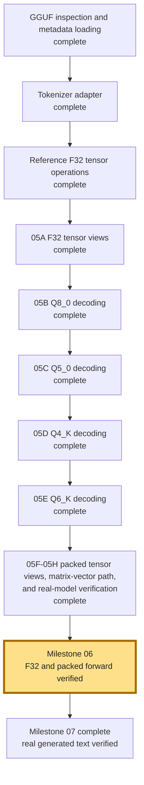

# Project Guide and From-Scratch Engine Checklist

This project is structured for you to implement model loading, CPU tensor math,
the forward pass and sampling yourself. A vocabulary-only llama.cpp
adapter handles GGUF tokenization; no external inference runtime executes model
layers. Check items off after the code exists and you have verified it.

## Build and run the skeleton

From the project root, run the build script:

```sh
./build.sh
./build/inference --help
```

Run the Qwen2.5-0.5B-Instruct Q4_K_M GGUF with the implemented greedy sampler:

```sh
./build/inference \
  --model models/qwen-2.5.gguf \
  --prompt "What is the capital of France?" \
  --max-tokens 16 --temperature 0 --top-p 1
```

The loader validates the GGUF, fills model dimensions, and loads the embedded
tokenizer through llama.cpp. The Qwen backend formats the instruction prompt,
decodes packed embeddings, and executes F32 or packed projections through the
full-prefix forward pass. Greedy selection chooses output tokens for the app
loop to decode and print. Follow the
[complete roadmap to generated text](docs/roadmap-to-generated-text.md) for
function contracts and verification commands.

### Verified model file

I inspected the local `models/qwen-2.5.gguf` file read-only:

- The file's SHA-256 is
  `74a4da8c9fdbcd15bd1f6d01d621410d31c6fc00986f5eb687824e7b93d7a9db`, which
  matches the [official Q4_K_M file](https://huggingface.co/Qwen/Qwen2.5-0.5B-Instruct-GGUF/blob/main/qwen2.5-0.5b-instruct-q4_k_m.gguf).
- It has GGUF magic, version 3, 291 tensors, and 26 metadata entries.
- Metadata identifies architecture `qwen2`, 24 transformer blocks, context
  length 32,768, embedding size 896, feed-forward size 4,864, 14 query heads,
  2 KV heads, and vocabulary size 151,936.
- The file-level quantization type is 15 (`MOSTLY_Q4_K_M` in the
  [GGUF specification](https://github.com/ggml-org/ggml/blob/master/docs/gguf.md)).
- Its tensor types are F32 (121), Q5_0 (133), Q8_0 (13), Q4_K (12), and Q6_K
  (12). Q4_K_M therefore means a mix of tensor types; the reader/kernel must
  support each type found in this file.

This verifies the downloaded artifact and provides implementation targets. The
C++ project parses its metadata, tokenizes instruction prompts, and supports
both the tiny F32 fixtures and the local model's packed weights.

## Progress snapshot

Model-file inspection, GGUF loading, tokenizer integration, reference CPU
math, F32/packed forward execution, greedy sampling, and single-user Qwen
prompt formatting are implemented. The generation loop has deterministic
sequencing, EOS, limit, and cleanup tests.

The automated suite contains 18 unit tests and four small integration tests.
They use synthetic fixtures and scripted backends, including a three-token,
four-dimensional cached-vs-full-prefix comparison. Real-model checks and their
build targets have been removed. See the [test commands](README.md#tests).

Historical acceptance on 2026-10-16 included 151,936 finite real-model logits,
context/lifecycle checks, and the CLI responses `Hello` and
`The capital of France is Paris.` That full CLI check took about 12 minutes;
it is no longer part of the automated suite. Packed embedding and projection
checks also passed AddressSanitizer and UndefinedBehaviorSanitizer.

The [quantized forward contracts](docs/milestone-06-quantized-forward.md) and
[Milestone 07 guide](docs/milestone-07-first-generated-text.md) describe the
implementations and focused tests. Performance optimization and stochastic
sampling remain later work; use `--temperature 0` for generation.



### Milestone 05 detail

| Submilestone | What it adds | Current status | Evidence / next step |
| --- | --- | --- | --- |
| [05A: F32 GGUF tensor views](docs/milestone-05a-f32-gguf-tensor-views.md) | Safe read-only views over F32 tensors in the mapped model file. | Complete | Fixture checks pass; a manual Qwen normalization-vector check was recorded. |
| [05B: Q8_0 reference decoding](docs/milestone-05b-q8-0-reference-decoding.md) | F16 scale conversion, 32-value Q8_0 decoding, and direct dot product. | Complete | `q8_0_reference_test` passed. |
| [05C: Q5_0 reference decoding](docs/milestone-05c-q5-0-reference-decoding.md) | Unpack the fifth bit and paired nibbles for 32 values; decode and dot directly. | Complete | `q5_0_reference_test` passed. A stronger fixture can exercise a set fifth bit in each of the four high-bit bytes. |
| [05D: Q4_K reference decoding](docs/milestone-05d-q4-k-reference-decoding.md) | Unpack eight 6-bit scale/minimum pairs and decode a 256-value block. | Complete | `q4_k_reference_test` passed. |
| [05E: Q6_K reference decoding](docs/milestone-05e-q6-k-reference-decoding.md) | Decode the remaining Q6_K blocks found in this model. | Complete | `q6_k_reference_test` passed. |
| [05F: packed tensor views](docs/milestone-05f-quantized-gguf-tensor-views.md) | Safely expose packed Q5_0, Q8_0, Q4_K, and Q6_K model tensors. | Complete | `gguf_quantized_view_test` passed. |
| [05G: quantized matrix-vector dispatch](docs/milestone-05g-quantized-matrix-vector-dispatch.md) | Accumulate every packed matrix row through its matching block-dot kernel. | Complete | `quantized_matvec_reference_test` passed. |
| [05H: real-model packed integration](docs/milestone-05h-real-model-quantized-integration.md) | Check each packed storage path against the downloaded Qwen GGUF. | Complete | `real_model_quantized_check` passed. |
| [06: full-prefix transformer forward pass](docs/milestone-06-transformer-forward.md) | Retain token history, recompute transformer layers, and produce logits without reusing K/V between calls. | Complete | Packed embeddings, shared weight dispatch, and mixed-weight logits are verified against F32; the local model forward/lifecycle check passes. See the [roadmap](docs/milestone-06-roadmap.md). |
| [07: first generated text](docs/milestone-07-first-generated-text.md) | Greedy selection, a single-user instruction prompt, and visible terminal output. | Complete | The CLI prints `Hello` and answers the France question correctly; all 23 tests pass with the local model configured. Optimization and stochastic sampling follow later. |

`inference_state_init` and `engine_forward_token` retain token IDs, recompute
the full prefix through the transformer layers, and produce logits with F32
or packed weights. Temporary K/V arrays are rebuilt on each forward call.
The greedy sampler and generation loop consume the logits to produce text.

## Project map

| Path | Responsibility |
| --- | --- |
| `src/main.cpp` | Creates configuration, parses CLI options, starts the app. |
| `include/app.h`, `src/app.cpp` | CLI configuration, prompt prefill, decode loop, cleanup, and metrics timing. |
| `include/engine.h`, `src/engine.cpp`, `src/gguf_reader.cpp`, `src/sampler.h`, `src/sampler.cpp` | Public engine API, shared GGUF/model lifecycle, prompt dispatch, and greedy sampling. |
| `src/architecture.h`, `src/architecture.cpp` | Select an architecture callback table from GGUF `general.architecture`. |
| `src/qwen2_architecture.h`, `src/qwen2_architecture.cpp`, `src/qwen2_internal.h` | Qwen2 metadata/tensor schema, private state, F32/packed forward pass, and instruction formatting. |
| `src/tokenizer.h`, `src/tokenizer.cpp` | llama.cpp tokenizer adapter: prompt encoding, token-piece decoding, and end-of-generation detection. |
| `include/terminal.h`, `src/terminal.cpp` | Prompt/output display, errors, and final metrics. |
| `include/metrics.h`, `src/metrics.cpp` | Wall time, process CPU time, resident RAM, and derived rates. |
| `CMakeLists.txt` | C++ standard, executable sources, include path, compiler warnings. |

The app control flow is:

```text
load model and tokenizer metadata
format instruction prompt -> encode it -> initialize inference state
forward prompt tokens -> recompute the prefix on each call, keep final logits
sample logits -> print token -> append and recompute if another token is needed
report metrics -> free temporary workspace and model resources
```

The final prompt token's logits predict the first generated token. Do not
forward that prompt token a second time. After sampling a generated token,
forward it once to produce logits for the next sampling step.

## Engine function contracts

Declarations are in `include/engine.h`. Greedy sampling is in
`src/sampler.cpp`; F32/packed forward execution and Qwen prompt formatting
are in `src/qwen2_architecture.cpp`.

- `engine_load_model`: map the GGUF file, validate its shared structure,
  select a backend, and set `Model.implementation` plus the dimensions in
  `Model.config`. It does not contain Qwen metadata names.
- `engine_format_prompt`: dispatch to the architecture's single-user prompt
  formatter, with an exact-byte contract for the local Qwen2.5 template.
- `tokenizer_encode`: implemented by the llama.cpp adapter using the model's
  embedded GGUF vocabulary and BPE rules. It respects the supplied output
  capacity.
- `inference_state_init`: allocate token-history, full-sequence scratch, and
  logits storage for the requested context length. Reject lengths beyond the
  model's context limit.
- `engine_forward_token`: append one token ID, recompute the full token history,
  and write next-token logits into `InferenceState.logits`.
- `sampler_sample`: validate arguments, route temperature zero to the greedy
  sampler, and report nonzero sampling as deferred. Greedy selection
  ignores valid `top_p` values, including zero.
- `tokenizer_is_eos` and `tokenizer_decode_one`: recognize model EOS IDs and
  convert an ordinary token ID to a NUL-terminated piece fitting
  `TOKEN_TEXT_CAPACITY`.
- `inference_state_destroy` and `engine_unload_model`: free owned state and
  remain safe after partial initialization failures.

The app handles prefill/decode sequencing; engine functions handle model math
and preserve token history across calls. The model state stays opaque outside the
engine, keeping the app procedural and independent of tensor storage details.

## Implementation checklist

### 1. Inspect the Q4_K_M GGUF file

The GGUF reader and metadata loader map the file read-only, check its structure,
and retain tensor descriptors. Reference math and decoders for all packed types
in the local file are implemented and integrated into the forward path.

- [x] Read the GGUF v3 header and reject unsupported versions or malformed files.
- [x] Parse metadata for architecture, dimensions, context length, vocabulary,
      tokenizer, and tensor types.
- [x] Parse the tensor directory and validate names, shapes, offsets, alignment,
      and file bounds before reading tensor data.
- [x] Identify the storage sizes for tensor types in this Q4_K_M file; reject
      unsupported types. Decoders and direct matrix-vector kernels are verified
      separately in Milestone 05.
- [x] Return errors for missing required tensors, unsupported tensor types, and
      truncated or corrupt files.

### 2. Tokenization through the llama.cpp adapter

- [x] Load the vocabulary, merge rules, UTF-8 behavior, and special-token
      metadata from the GGUF using a vocabulary-only llama.cpp model load.
- [x] Encode prompts into IDs and fail clearly when the output array is too
      small.
- [x] Decode one token piece and recognize end-of-generation tokens.
- [x] Apply the Qwen instruction chat template before encoding the user's
      prompt.
- [x] Wire architecture prompt dispatch and enable special-token parsing in
      the tokenizer adapter; verify role/end markers against the local GGUF.
- [ ] Replace the adapter with a project-owned BPE implementation if you later
      choose to learn tokenizer internals.

### 3. Build and verify CPU tensor operations

- [x] Add reference operations for vector/matrix multiplication, dot products,
      normalization, and softmax.
- [x] Implement dequantization or direct quantized matrix-vector operations for
      the tensor types used by Q4_K_M.
- [x] Compare small hand-checkable tensor results against expected values.
- [x] Check tensor shapes and report lookup or calculation failures at the
      Qwen forward-helper boundaries.

### 4. Implement model loading and one-token forward

- [x] Implement GGUF metadata loading and populate vocabulary size/context
      limit; validate required Qwen tensor shapes, including final normalization.
- [x] Implement `inference_state_init` with token-history and full-prefix scratch storage.
- [x] Implement the F32 forward schedule for embeddings, positional encoding,
      attention, MLP, residual paths, final normalization, and output logits.
- [x] Make forward append one token and recompute all positions in the history.
- [x] Verify one forward pass on a tiny known configuration before using full
      Qwen weights.
- [x] Obtain and validate the packed embedding tensor view.
- [x] Decode the selected quantized embedding row into floats.
- [x] Connect packed matrix-vector dispatch to layer and final output projections.
- [x] Pass the real-model forward check and the suite with all Milestone 06
      checks enabled.

### 5. Implement sampling and generation

- [x] Implement greedy sampling for temperature zero.
- [ ] Implement temperature scaling and top-p filtering for nonzero temperature.
- [x] Document `top_p == 0` on the greedy path: accepted and ignored. Stochastic
      behavior is deferred along with nonzero-temperature sampling.
- [x] Verify prefill forwards prompt IDs once and uses final prefill logits for
      the first sample.
- [x] Verify each sampled non-EOS token is forwarded once only when another
      sample is needed; stop at EOS or `max_tokens`.
- [x] Test loop errors, invalid IDs/logits, and cleanup with a scripted backend.
- [x] Check engine context exhaustion and return a useful error.

### 6. Complete lifecycle and end-to-end checks

- [x] Verify inference-state cleanup after success and rejected initialization,
      and a successful retry after a failed forward call.
- [x] Verify the complete real-model lifecycle through successful forward and
      forced failure.
- [x] Run Qwen with a short prompt and confirm readable text output.
- [x] Check a one-token limit, maximum-length prompt/context rejection, and
      invalid path with the CLI; cover EOS and unsupported tensor types with fixtures.
- [x] Confirm elapsed time, generated token count, and tokens/s are reported.
- [ ] Confirm CPU/RAM appear or are reported unavailable when OS queries fail.
- [x] Confirm CLI help and invalid arguments still work in the app contract test.

## Existing behavior and limits

- CLI options are `--model`, `--prompt`, `--max-tokens`, `--temperature`, and
  `--top-p`; defaults are 128, 0.8, and 0.95 for generation settings.
- The CLI restricts temperature and top-p to `[0, 1]`.
- `app.cpp` uses a fixed prompt-token capacity of 32,768 IDs. The engine must
  also check the loaded model's smaller context limit.
- Generation timing excludes model loading and prompt prefill. Throughput
  counts sampled tokens, including EOS if sampled. CPU is process
  CPU time divided by wall time and can exceed 100% on multiple cores. RAM is
  resident memory sampled at the end.
- The project has been built on macOS. The metrics implementation has a Linux
  path that still needs a Linux build check.
