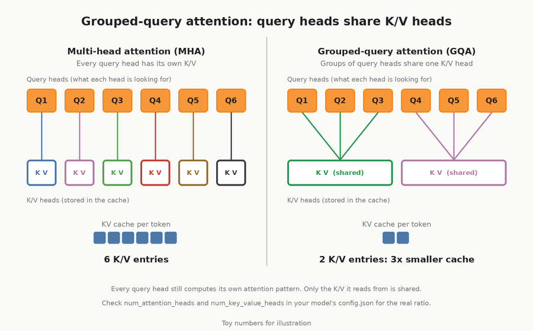
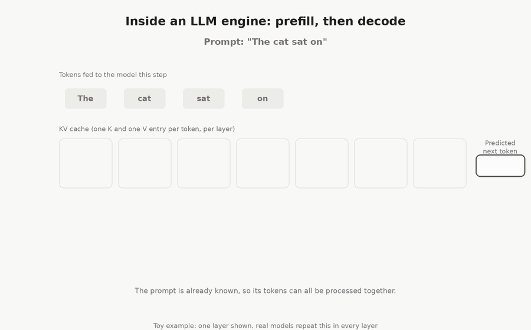

# My Own Inference Engine

This is a procedural C++ implementation of a terminal text-generation engine.
`engine.cpp` memory-maps a GGUF file, selects an architecture backend from
`general.architecture`, and owns shared model/tokenizer lifecycle. The Qwen2
metadata keys, tensor checks, and forward pass are isolated in
`qwen2_architecture.cpp`. `tokenizer.cpp` delegates GGUF tokenizer behavior to
a vocabulary-only llama.cpp adapter. CPU tensor math and the complete F32
reference forward pass are implemented; no external inference runtime executes
model layers. Each forward call recomputes the complete token history without
retaining K/V results between calls.

Packed embedding-row decoding, packed layer/output projections, greedy
selection, and single-user Qwen2.5 instruction prompt formatting are implemented.
The existing app loop prints generated token pieces and stops at EOS or the
requested token limit. See the [roadmap to generated text](docs/roadmap-to-generated-text.md)
for the function contracts, tests, and commands. Optimization is deferred.

The [optimization roadmap](docs/optimization-roadmap.md) ranks proposed changes
from small math fixes through one-pass prefill, KV caching, CPU kernels, and a
GPU backend, with expected benefits and validation requirements.

## Inside the engine

### Grouped-query attention

The Qwen2 backend implements grouped-query attention: groups of query heads
share key and value heads. The diagram uses illustrative head counts to show
how this layout reduces the K/V storage needed compared with multi-head attention.



### Prefill, decode, and KV caching

The animation shows prompt prefill followed by token-by-token decoding with
a persistent KV cache. KV caching and one-pass prefill are planned in the
[optimization roadmap](docs/optimization-roadmap.md); the current backend
recomputes the full token history on each forward call.



## Build and run

```sh
./build.sh
./build/inference --model models/qwen-2.5.gguf --prompt "Hello" \
  --max-tokens 16 --temperature 0 --top-p 1
```

The first build downloads a pinned llama.cpp source dependency through CMake.
It is used for BPE tokenization and token-piece decoding only.

OpenMP is enabled by default for the engine's CPU kernels. On macOS, install
the runtime with `brew install libomp`; CMake discovers the standard Apple
Silicon and Intel Homebrew locations automatically. For a custom installation,
pass `-DOpenMP_ROOT=/path/to/libomp` when configuring. Configuration fails if
OpenMP is enabled but its compiler support or runtime cannot be found.

Set the CPU worker count when launching the executable, for example:

```sh
OMP_NUM_THREADS=4 ./build/inference --model models/qwen-2.5.gguf \
  --prompt "Hello" --max-tokens 16 --temperature 0 --top-p 1 --profile
```

To build serial CPU kernels, configure with
`cmake -S . -B build -DENGINE_OPENMP=OFF` and rebuild. Re-enable with
`-DENGINE_OPENMP=ON`. Both F32 and packed quantized matvecs parallelize their
independent output rows. Q5_0, Q8_0, Q4_K, and Q6_K keep their existing unpacking
and accumulation order within each row.

Use `--temperature 0` for the implemented greedy sampler. The CLI default
is still `0.8`; nonzero-temperature/top-p sampling reports a clear unsupported
error until that later feature is implemented. Full-prefix recomputation can
make prefill and generation slow.

The CLI accepts `--max-tokens`, `--temperature`, and `--top-p`; run with
`--help` to see defaults and accepted values. `src/app.cpp` contains a separate
prompt-prefill loop and token-decode loop. The detailed implementation map and
checklist are in [PROJECT_GUIDE.md](PROJECT_GUIDE.md).

Metrics report generation elapsed time, throughput, process CPU percentage,
and current resident RAM when supported by macOS or Linux. CPU percentage can
exceed 100% when multiple cores are used.

## Tests

The automated suite contains unit tests and four small integration tests using
synthetic tensors or scripted backends. It never loads a real model. Each test
has a 30-second timeout.

```sh
./build.sh
ctest --test-dir build --output-on-failure

# Run either group independently.
ctest --test-dir build -L '^unit$' --output-on-failure
ctest --test-dir build -L '^integration$' --output-on-failure

# Tiny cached-vs-full-prefix comparison: one layer, dim 4, three token IDs.
cmake --build build --target forward_reference_test
ctest --test-dir build -R '^forward_reference_test$' --output-on-failure
```

The real-model acceptance executables and CLI smoke test have been removed.
Older milestone documents retain historical evidence of their results; use
the commands above for the current automated suite.

### Operation timings

Add `--profile` to collect and print an operation breakdown after generation:

```sh
./build/inference --model models/qwen-2.5.gguf --prompt "What's the capital of France?" \
  --max-tokens 16 --temperature 0 --top-p 1 --profile
```

The report shows accumulated milliseconds and percentages for layer matvecs
(Q/K/V, attention output, and FFN projections), attention scores/softmax/value
aggregation, RMSNorm, RoPE, and the output matrix plus sampling. Output projection
time is excluded from the layer matvec row. Projection timings include weight
lookup, storage dispatch, and Q/K/V bias addition.

Totals cover **prompt prefill and generation**, including full-prefix
recomputation, across all forward and sampling calls. Percentages use total
forward time plus sampling time; an **other forward work** row accounts for
embeddings, SwiGLU, residual additions, copies, validation, and instrumentation
overhead. Loading, tokenization, and terminal output are excluded. These totals
therefore cover a different interval from the existing generation-only elapsed
time and throughput. Timings use a monotonic wall clock and can include OS
scheduling delays. Omitting `--profile` disables operation timing and its report.
