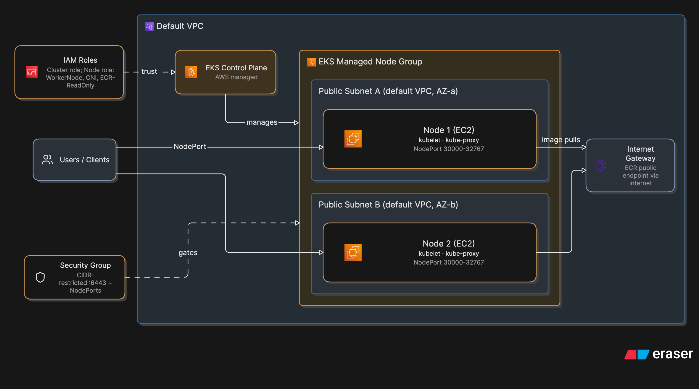
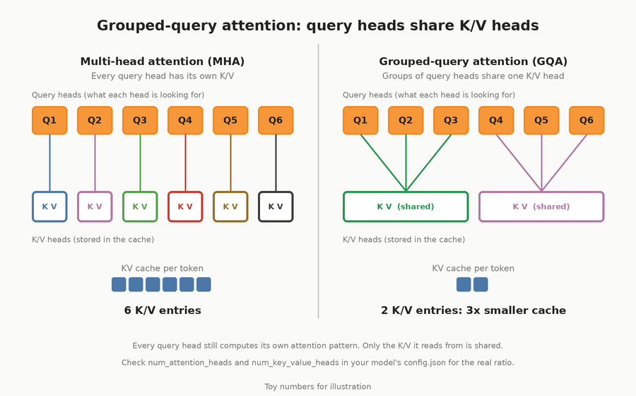
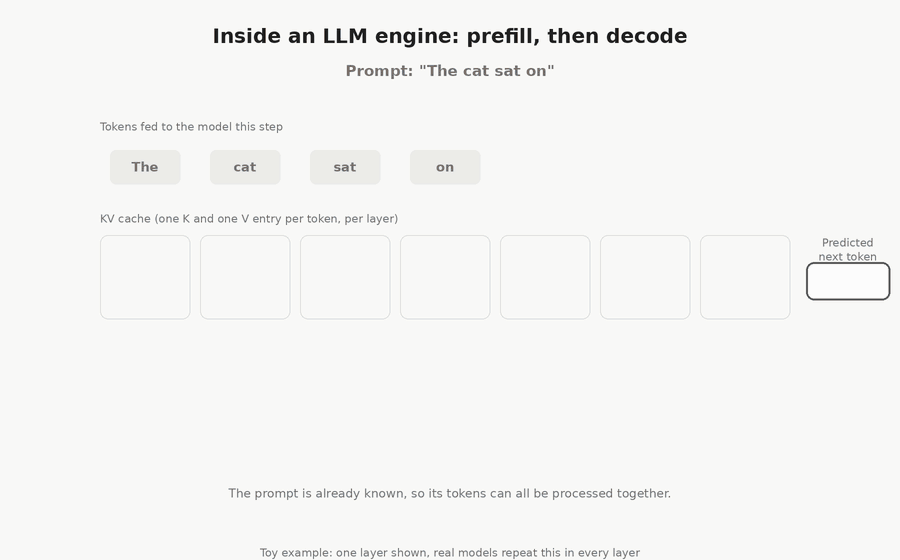
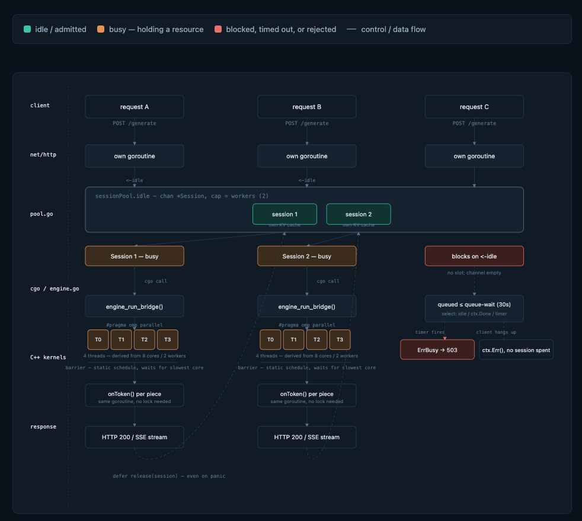

# My Own Inference Engine

This is a procedural C++ implementation of a terminal text-generation engine.
`engine.cpp` memory-maps a GGUF file, selects an architecture backend from
`general.architecture`, and owns shared model/tokenizer lifecycle. The Qwen2
metadata keys, tensor checks, and forward pass are isolated in
`qwen2_architecture.cpp`. `tokenizer.cpp` delegates GGUF tokenizer behavior to
a vocabulary-only llama.cpp adapter. CPU tensor math and the complete F32
reference forward pass are implemented; no external inference runtime executes
model layers. Token-by-token inference uses a per-layer K/V cache; a full-prefix
reference path remains available for correctness checks.

Packed embedding-row decoding, packed layer/output projections, greedy
selection, and single-user Qwen2.5 instruction prompt formatting are implemented.
The existing app loop prints generated token pieces and stops at EOS or the
requested token limit. See the [roadmap to generated text](docs/roadmap-to-generated-text.md)
for the function contracts, tests, and commands. For an explanation of the
implemented packed-weight SIMD optimization, start with the
[beginner's NEON guide](docs/quantized-neon-beginners-guide.md).

The [optimization roadmap](docs/optimization-roadmap.md) ranks proposed changes
from small math fixes through one-pass prefill, KV caching, CPU kernels, and a
GPU backend, with expected benefits and validation requirements.

## Architecture

End to end: the C++ engine behind a stable C ABI, a Go server that pools
sessions and streams tokens over it via cgo, and three deployment layers —
Docker Compose, k3d, and AWS EKS — running copies of that server behind a
load balancer.



## Demo

<video src="media/demo.mp4" controls muted playsinline width="100%"></video>

## Inside the engine

### Grouped-query attention

The Qwen2 backend implements grouped-query attention: groups of query heads
share key and value heads. The diagram uses illustrative head counts to show
how this layout reduces the K/V storage needed compared with multi-head attention.



[Explore MHA, GQA, and MQA interactively](docs/attention-heads-interactive.html) — open the HTML file in a browser to change head counts and inspect KV-cache sharing.

### Prefill, decode, and KV caching

The animation shows prompt prefill followed by token-by-token decoding with
a persistent KV cache. The current backend uses a persistent per-layer KV cache during token-by-token
inference. Prompt prefill uses bounded layer-first chunks, batched weight
projections, causal per-position attention, and the same persistent K/V cache;
see the [batched prefill implementation plan](docs/batched-prefill-implementation-plan.md)
for its stages, risks, and tests, or the
[optimization roadmap](docs/optimization-roadmap.md) for historical context.



## Build and run

```sh
./build.sh
./build/inference --model models/qwen-2.5.gguf --prompt "Hello" \
  --max-tokens 16 --temperature 0 --top-p 1
```

The first build downloads a pinned llama.cpp source dependency through CMake.
It is used for BPE tokenization and token-piece decoding only.

OpenMP is enabled by default for the engine's CPU kernels. On macOS, install
the runtime with `brew install libomp`; CMake discovers the standard Apple
Silicon and Intel Homebrew locations automatically. For a custom installation,
pass `-DOpenMP_ROOT=/path/to/libomp` when configuring. Configuration fails if
OpenMP is enabled but its compiler support or runtime cannot be found.

Set the CPU worker count when launching the executable, for example:

```sh
OMP_NUM_THREADS=4 ./build/inference --model models/qwen-2.5.gguf \
  --prompt "Hello" --max-tokens 16 --temperature 0 --top-p 1 --profile
```

Any thread count works; tune it for your machine. Leaving `OMP_NUM_THREADS`
unset means "all cores", which is not necessarily the fastest setting — on an
8-core M2, four threads beat eight. Measurements and the reason are in
[server/README.md](server/README.md#openmp-threads).

To build serial CPU kernels, configure with
`cmake -S . -B build -DENGINE_OPENMP=OFF` and rebuild. Re-enable with
`-DENGINE_OPENMP=ON`. Both F32 and packed quantized matvecs parallelize their
independent output rows. On ARM64, Q5_0, Q8_0, Q4_K, and Q6_K use NEON within
each block; other builds retain scalar block-dot kernels. SIMD summation may
change floating-point rounding; see the [beginner's NEON guide](docs/quantized-neon-beginners-guide.md).

Use `--temperature 0` for the implemented greedy sampler. The CLI default
is still `0.8`; nonzero-temperature/top-p sampling reports a clear unsupported
error until that later feature is implemented. The app submits prompt tokens
through a checked prefill API. Qwen2 batches up to eight positions through each
layer and computes the final normalization and vocabulary projection only for
the last prompt token. Generation remains single-token cached decode.

The CLI accepts `--max-tokens`, `--temperature`, and `--top-p`; run with
`--help` to see defaults and accepted values. `src/app.cpp` contains a separate
prompt-prefill loop and token-decode loop. The detailed implementation map and
checklist are in [PROJECT_GUIDE.md](PROJECT_GUIDE.md).

Metrics report generation elapsed time, throughput, process CPU percentage,
and current resident RAM when supported by macOS or Linux. CPU percentage can
exceed 100% when multiple cores are used.

The completion summary always reports **time to first token**, measured from
immediately after model loading through printing the first nonempty token piece.
This includes prompt formatting, tokenization, inference-state setup, prefill,
and the first token's sampling, decoding, and output. It reports `unavailable`
if no text is emitted or timing is unavailable. The existing elapsed time and
throughput cover generation after prefill.

## Serving it over HTTP

`libengine` is also built as a shared library with a stable C ABI
([include/engine_api.h](include/engine_api.h)), so the engine can be embedded in
a host process. A Go HTTP server lives in [server/](server/README.md).

```sh
cmake --build build --target engine      # produces libengine
cd server && go run . -threads 4
```

Opaque handles keep the ABI free of internal struct layouts: an `EngineHandle`
holds the read-only weights and is shared across threads, while an
`EngineSession` holds one request's KV cache and activations. Sessions are
reusable with no reallocation, and several can generate concurrently on one
handle.

Each request crosses two thread pools that do not coordinate: Go admits it
through a buffered channel of sessions (the pool, the queue, and the semaphore
in one), then a single cgo call hands it to the engine, where OpenMP fans it
out across its own thread team. The diagram shows two admitted requests and a
third queuing until the wait expires into a 503:



The walkthrough is in [server/README.md](server/README.md#request-lifecycle).

One finding worth stating plainly: **concurrency does not increase throughput
here.** Four simultaneous requests take the same total wall time as four
sequential ones, because each one independently streams the whole weight set
from RAM and bandwidth is already the bottleneck. Concurrency changes *when*
each client gets an answer, not how much work the machine does. The fix for
throughput is batching — one weight read serving many requests — which is an
engine change, not a serving change.

Design notes and the phased plan:
[docs/serving-implementation-plan.md](docs/serving-implementation-plan.md), and
[docs/why-go.md](docs/why-go.md) for the language choice.

### Running more than one

Three deployment layers exist, each adding guarantees the previous one lacks.
The thread budget multiplies across all of them: `replicas x workers x threads`
must stay at or under the available cores.

- **Docker Compose** ([compose.yaml](compose.yaml)) — two replicas on one host
  behind an nginx gateway ([deploy/nginx.conf](deploy/nginx.conf)) that
  balances with `least_conn` and disables proxy buffering so SSE streams
  token by token. Replicas share one set of mmap'd model pages through the
  page cache. No readiness gating, no rolling updates, no reconciliation.
- **k3d / Kubernetes** ([deploy/k8s/](deploy/k8s/)) — a Deployment reconciles
  the replica count and rolls updates without dipping below it; a Service
  routes only to pods passing `/health/ready`, so a pod still loading the
  model receives no traffic. NodePort rather than Ingress, because ingress
  proxies buffer SSE.
- **EKS** ([infra/](infra/), [deploy/k8s/eks/](deploy/k8s/eks/)) — Terraform
  for the same manifests on AWS nodes; a bootstrap step places the model at
  the `hostPath` every node mounts.

The full tour, including what Compose cannot do and why that argues for
Kubernetes, is in [server/README.md](server/README.md#infra-running-more-than-one-of-these).

## Tests

The automated suite contains unit tests and four small integration tests using
synthetic tensors or scripted backends. It never loads a real model. Each test
has a 30-second timeout.

```sh
./build.sh
ctest --test-dir build --output-on-failure

# Run either group independently.
ctest --test-dir build -L '^unit$' --output-on-failure
ctest --test-dir build -L '^integration$' --output-on-failure

# Tiny cached-vs-full-prefix comparison: one layer, dim 4, three token IDs.
cmake --build build --target forward_reference_test
ctest --test-dir build -R '^forward_reference_test$' --output-on-failure
```

The older real-model acceptance executables and CLI smoke test have been
removed. Older milestone documents retain historical evidence of their results;
use the commands above for the current automated suite.

Two further suites exist outside `ctest`, both needing `models/qwen-2.5.gguf`:

```sh
# C ABI contract: session reuse, cancellation, rejection, 4-way concurrency.
# Written in C on purpose, which is what proves engine_api.h works from a
# C toolchain (and therefore from cgo).
cmake --build build --target engine_api_smoke_test
./build/engine_api_smoke_test

# Go server. -short skips everything that loads the model.
cd server
go test -short ./...   # fast
go test ./...          # ~17 s, real inference through cgo
```

### Quantized matvec microbenchmark

To compare the four packed formats with the same synthetic matrix dimensions:

```sh
cmake --build build --target quantized_matvec_benchmark
OMP_NUM_THREADS=4 ./build/quantized_matvec_benchmark            # 1024 rows, 1024 columns, 10 calls
OMP_NUM_THREADS=4 ./build/quantized_matvec_benchmark 4096 2048 20
```

The output reports median milliseconds per complete matvec, millions of logical
weights per second, and packed matrix size. Columns must be a multiple of 256.
This benchmarks the existing packed dispatch and block-dot code, **not** a real
model or isolated dot instructions. Formats store different bytes per weight;
compare each format against itself before and after a kernel change. Use the
same build, dimensions, and thread count for comparisons.

### Operation timings

Add `--profile` to collect and print an operation breakdown after generation:

```sh
./build/inference --model models/qwen-2.5.gguf --prompt "What's the capital of France?" \
  --max-tokens 16 --temperature 0 --top-p 1 --profile
```

The report shows accumulated milliseconds and percentages for layer projections
(Q/K/V, attention output, and FFN projections), attention scores/softmax/value
aggregation, RMSNorm, RoPE, and the output matrix plus sampling. Output projection
time is excluded from the layer matvec row. Projection timings include weight
lookup, storage dispatch, and Q/K/V bias addition. A second table reports the
actual F32/Q5_0/Q8_0/Q4_K/Q6_K weight-kernel wall time and call count, with
layer and output projections separated. Its shares are percentages of timed
weight kernels only; these times are already included in the operation rows,
not additional time. A prefill batched-kernel call covers several positions, so
call counts are not directly comparable with the older per-token path. Both
tables combine prefill and decode.

Totals cover **prompt prefill and generation**, including chunked prefill and
cached generated-token forwards, across all forward and sampling calls. Percentages use total
forward time plus sampling time; an **other forward work** row accounts for
embeddings, SwiGLU, residual additions, copies, validation, and instrumentation
overhead. Loading, tokenization, and terminal output are excluded. These totals
therefore cover a different interval from the existing generation-only elapsed
time and throughput. Timings use a monotonic wall clock and can include OS
scheduling delays. Omitting `--profile` disables operation timing and its report.
