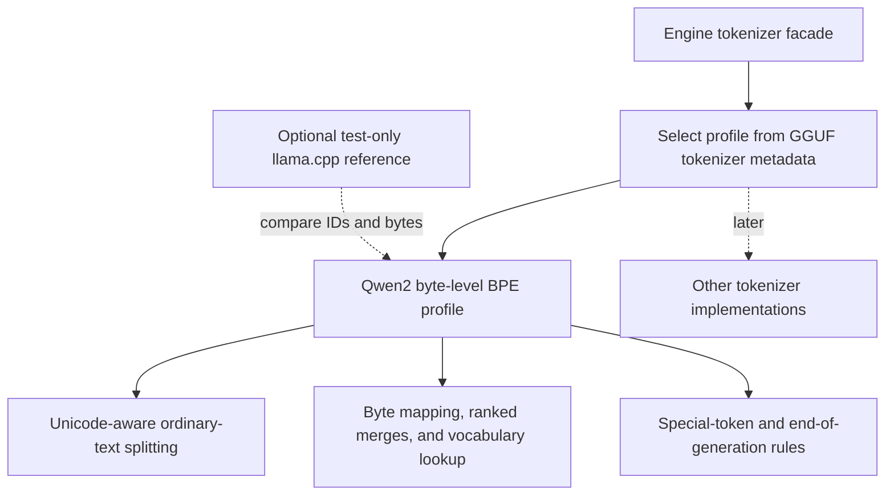

# Native BPE Tokenizer: Draft Implementation Plan

**Status: draft for review. Implementation must wait until you explicitly ask
for it.** This document proposes a replacement for the llama.cpp tokenizer
adapter. It does not authorize changing the tokenizer, dependencies, or build.

## Confirmed decisions

| Decision | Agreed direction |
| --- | --- |
| Initial scope | Exact compatibility for the current Qwen2.5 GGUF, with room for other implementations later. |
| Compatibility reference | Preserve the current pinned llama.cpp adapter's behavior. |
| Unicode support | A Unicode/regex helper dependency is allowed; our code will implement BPE. |
| Delivery | Review this plan first. Do not implement until explicitly requested. |

The proposal for llama.cpp after migration is **optional reference tests,
disabled by default**. This is a proposed build arrangement for review, not
an implemented change.

## Goal

Replace the three functions currently supplied through llama.cpp:

- Text encoding into the model's existing token IDs.
- Token-piece decoding into output bytes.
- End-of-generation detection.

Replacing encoding alone would leave the executable dependent on llama.cpp for
decoding and stop detection. The complete replacement should remove that runtime
dependency while keeping the existing inference behavior.

We will reuse the vocabulary and merges embedded in the GGUF. We will not train
a new tokenizer, renumber tokens, or modify model weights. This work changes
tokenization ownership; it does not address the long transformer prefill time.

## What is already available

Read-only inspection of `models/qwen-2.5.gguf` found:

| Metadata | Local value |
| --- | --- |
| `tokenizer.ggml.model` | `gpt2` |
| `tokenizer.ggml.pre` | `qwen2` |
| `tokenizer.ggml.tokens` | 151,936 strings |
| `tokenizer.ggml.token_type` | 151,936 signed 32-bit entries |
| `tokenizer.ggml.merges` | 151,387 strings |
| `tokenizer.ggml.eos_token_id` | 151645: `<\|im_end\|>` |
| `tokenizer.ggml.bos_token_id` | 151643: `<\|endoftext\|>` |
| `tokenizer.ggml.padding_token_id` | 151643 |
| `tokenizer.ggml.add_bos_token` | false |

`<|im_start|>` is token 151644 in this file. These IDs are inspection evidence,
not values to hardcode into a general loader. Look up metadata and vocabulary
entries when loading a model. Record reference-resolved defaults for optional
fields that are absent, rather than treating absence as a universal setting.

The existing [GGUF reader](../src/gguf_reader.h) already exposes string, integer,
boolean, and array access. The current
[tokenizer adapter](../src/tokenizer.cpp) calls:

- `llama_tokenize` with `add_special = true`, `parse_special = true`.
- `llama_token_to_piece` with special-token rendering disabled.
- `llama_vocab_is_eog`, which can recognize more than the single EOS metadata ID.

The reference revision is pinned in [CMakeLists.txt](../CMakeLists.txt):
`a7b94df2c616bc1f62a73b964b4a71cb0dcc488e`.

## Compatibility contract

The primary target is the same token-ID sequence as that adapter for the same
supported input and GGUF. Merely decoding back to similar-looking text is not
enough: different token IDs change the model's inputs.

Preserve these details:

- Unicode-aware Qwen splitting, including contractions, digits, punctuation,
  spaces, tabs, and newline behavior.
- The reversible byte-to-symbol mapping used by the stored BPE vocabulary.
- Merge priority from the **merge-list position**, not token ID or token length.
- Deterministic handling of repeated/equal-priority merge opportunities.
- Special-token matching, adjacency, and surrounding whitespace behavior.
- Automatic BOS/EOS settings and the complete end-of-generation behavior.
- Decoded bytes and the current policy for rendering special tokens.
- Capacity errors, optional error buffers, and model/tokenizer lifecycle safety.

Use the pinned adapter as the authority when implementations disagree. Qwen's
upstream tokenizer is useful supporting documentation, but some versions have
different Unicode normalization behavior. Do not introduce NFC normalization,
case folding, whitespace cleanup, or a prefix space just because another
tokenizer implementation does so. The upstream
[Qwen2 tokenizer source](https://github.com/huggingface/transformers/blob/v4.45.2/src/transformers/models/qwen2/tokenization_qwen2.py)
illustrates why generic GPT-2 splitting is insufficient and why implementation
versions matter.

The current input API accepts NUL-terminated strings. Embedded NUL input is
outside that API's expressible input domain. Internal algorithms and reference
comparisons should nevertheless use explicit byte lengths, including when a
decoded token contains a NUL byte or an incomplete UTF-8 sequence.

## Proposed architecture

Keep the procedural C-style C++ approach and the engine's existing public
tokenizer entry points. Add a small internal dispatch boundary so Qwen is the
first supported profile without making every future family a Qwen special case.



Select tokenizer behavior from `tokenizer.ggml.model` and `tokenizer.ggml.pre`,
not the transformer architecture name alone. Several model families can share
a tokenizer algorithm, and different pre-tokenizers can share a BPE core.

Suggested responsibilities, subject to refinement during implementation:

| File or area | Responsibility |
| --- | --- |
| `src/tokenizer.cpp` | Shared argument checking and dispatch behind the existing engine API. |
| `src/tokenizer.h` | Internal loading/destruction interface. |
| Proposed `src/tokenizer_internal.h` | Opaque native tokenizer state and a small operations table. |
| Proposed `src/bpe_tokenizer.cpp/.h` | Vocabulary maps, byte mapping, merge ranks, and the BPE core. |
| Proposed `src/qwen2_tokenizer.cpp/.h` | Qwen pre-tokenization profile and compatibility rules. |
| Proposed `src/tokenizer_unicode.cpp/.h` | Isolate the selected Unicode/regex dependency. |
| `src/engine_internal.h` | Store native tokenizer ownership instead of llama model/vocabulary handles. |
| Proposed `tests/tokenizer_llama_reference.cpp` | Optional comparison adapter with separate test-only function names. |

Keep these implementation headers in `src/`. The public engine API can remain
in `include/engine.h`. A tokenizer operations table is enough for the first
extension point; a general plugin system is unnecessary.

Load directly from the `GgufFile` the engine already owns, rather than reopening
the model through another library. Vocabulary strings borrowed from the mapping
need explicit lengths and must not outlive it. Owned lookup tables and scratch
storage need checked allocation sizes and cleanup after partial initialization.
Avoid global library lifecycle state in the native implementation.

## Unicode helper proposal

Use a Unicode-aware regex engine such as PCRE2 behind the private Unicode
wrapper. Pin its version and Unicode behavior. Our code still owns byte
mapping, merges, vocabulary lookup, special tokens, decoding, and stop rules.
PCRE2 distinguishes UTF processing from Unicode character-class behavior; see
its [Unicode documentation](https://www.pcre.org/current/doc/html/pcre2unicode.html).

A matching regex string alone does not guarantee parity. Whitespace classes,
Unicode versions, and case-insensitive matching can differ from the pinned
adapter. Validate split boundaries, including recently assigned characters and
unusual whitespace, before accepting this dependency choice. If tables disagree,
use a compatible version or explicit profile rules rather than silently changing
the reference behavior. Leave JIT and tokenizer performance tuning for later.

## Implementation stages

### 1. Freeze reference behavior and fixtures

Before replacing the adapter, capture a deterministic corpus of input bytes,
token IDs, decoded token-piece bytes, and stop flags. Include the fully formatted
instruction prompt, not just isolated words.

Record the GGUF hash, pinned llama.cpp revision, adapter flags, and fixture
generator version in a manifest. Freeze the full end-of-generation set for the
local vocabulary. Additional stop rules inferred by llama.cpp must be visible
in the compatibility profile; EOS metadata alone is insufficient.

**Exit criterion:** fixtures explain the behavior the native implementation
must preserve and can be tested without running transformer layers.

### 2. Load native vocabulary and merge data

Parse the existing GGUF arrays and construct ID-to-entry, entry-to-ID, merge-rank,
and special-token lookup structures. Validate array types/counts, IDs, duplicate
or malformed entries according to the supported profile, checked sizes, and
required byte coverage. Avoid a vocabulary scan for every merge lookup.

An unsupported tokenizer profile should fail clearly rather than silently use
Qwen rules. Unsupported metadata features must likewise be reported explicitly.

**Exit criterion:** synthetic malformed fixtures fail safely, and the real GGUF
loads the expected native tables with correct ownership and cleanup.

### 3. Implement byte mapping and token-piece decoding

Implement the reversible 256-byte mapping and its inverse. Build a private
length-aware token-piece decode operation and keep the current public wrapper's
behavior while the app API remains unchanged.

Compare raw bytes. A single token may contain only part of a multibyte character;
do not insert replacement characters into each piece independently. Special
tokens must follow the reference's rendering policy.

**Exit criterion:** all 256 byte mappings round-trip, ordinary vocabulary pieces
match reference bytes, and capacity/special-token cases match the adapter.

### 4. Implement special-token partitioning and Qwen splitting

Recognize appropriate special tokens before applying ordinary-text splitting.
Preserve the pinned reference's matching precedence, including overlapping or
adjacent candidates. Token metadata and resolved profile rules decide which
entries are special; angle-bracket spelling alone does not.

Split ordinary UTF-8 text into Qwen-compatible chunks without trimming or losing
bytes. Validate this stage independently so a splitting mismatch is not confused
with a merge-loop bug.

**Exit criterion:** reference chunk-boundary cases and special-token cases agree,
including mixed scripts, spaces/newlines, and literal marker-like text.

### 5. Implement the ranked BPE merge core

Start each ordinary chunk with its byte-level units, apply the stored merge
priorities, and resolve the remaining symbols to existing vocabulary IDs.
Merges must not cross pre-tokenization or special-token boundaries.

Begin with a readable deterministic implementation that rechecks adjacent
candidates. A priority queue and caching can follow only if measured tokenizer
cost warrants them. Do not substitute longest-string matching for ranked BPE.

Stage results before publishing a successful public encode result so capacity
failure cannot leave the caller with an apparently valid partial token list.

**Exit criterion:** hand-checkable merge fixtures pass and real-model token IDs
match the frozen corpus exactly, including merge-order adversarial cases.

### 6. Complete differential compatibility testing

Exercise the whole native pipeline against the pinned reference, using both
saved fixtures and the optional live comparison target when enabled.

Use these test groups:

| Group | Coverage |
| --- | --- |
| Basic text | Empty input, words, leading/trailing spaces, repeated spaces. |
| Qwen splitting | Contractions and case variants, digits, punctuation runs, tabs, LF and CRLF, trailing whitespace. |
| Unicode | Vietnamese, CJK, emoji/ZWJ sequences, combining marks, composed/decomposed forms, non-ASCII whitespace. |
| Special tokens | Full instruction prompt, adjacent markers, markers inside text, overlapping prefixes, incomplete marker-like strings. |
| BPE behavior | No merge, chained merges, competing ranks, repeated pairs, deterministic ordering, chunk boundaries. |
| Decoding and stops | Byte-exact pieces, partial UTF-8, special-token suppression, full EOG membership. |
| API and ownership | Nulls, invalid IDs, small/exact capacities, failure outputs, repeated loads, partial-load cleanup, independent models. |
| Differential corpus | Deterministically generated valid UTF-8 inputs with a fixed seed and persisted failing examples. |

Round-trip tests alone are insufficient: different tokenizations can produce
the same reconstructed text. ID comparisons must be exact. Characterize malformed
UTF-8 behavior separately before defining its native error policy; do not claim
compatibility for inputs whose reference behavior has not been established.

**Exit criterion:** no unexplained token-ID, byte-piece, or stop-set mismatches
in the agreed corpus, plus passing boundary and lifecycle checks.

### 7. Switch the runtime and remove mandatory llama.cpp linkage

Keep the working adapter in place until native compatibility tests are ready.
Develop the native implementation in isolated test targets during that period.
Then switch the engine facade to the native implementation and remove the
runtime llama handles, backend initialization, and adapter logging hooks.

Update every affected target in CMake, not just `inference`: current state,
forward, prompt-dispatch, and real-model checks also link llama.cpp. Run the
existing numerical/app tests and the real schema/marker checks. Finally run
the real generated-text smoke test as an integration check; its output alone
does not establish tokenizer parity.

**Exit criterion:** the default executable and standard tests build and run
without fetching, compiling, linking, or loading llama.cpp/GGML. Verify this
with a clean build, not only an existing cached build directory.

## Optional reference tests and build time

Proposed final CMake setting:

```text
TOKENIZER_ENABLE_LLAMA_REFERENCE = OFF
```

| Final configuration | llama.cpp effect |
| --- | --- |
| Default build | None: no unconditional FetchContent call or llama/GGML build dependency. Saved reference fixtures run normally. |
| Reference tests explicitly enabled | Fetch/use the pinned source and build the reference library for test targets only. Initial build costs extra time; later builds can reuse artifacts. |
| Reference tests disabled again | Runtime and ordinary tests remain independent of the reference library. |

The Unicode/regex helper remains a separate allowed dependency and can still
cost download/build time. Removing mandatory llama.cpp does not mean a completely
dependency-free build. Actual build-time improvements should be measured.

During development before cutover, the current runtime will still need llama.cpp.
The final off-by-default arrangement starts once the native runtime is ready.
If even optional reference builds are undesirable, the alternative is to keep
only versioned saved fixtures and an external regeneration procedure.

## Items to settle during plan review

1. **Reference-test packaging:** accept the proposed optional, off-by-default
   oracle, or retain saved fixtures only. Your build-time question motivated the
   default-off proposal; it has not been treated as an instruction to enable it.
2. **Concrete Unicode library/version:** PCRE2 is the proposed starting point,
   contingent on its splitting behavior matching the pinned reference.
3. **Malformed UTF-8 contract:** characterize current behavior, then document
   supported inputs and safe failure semantics before implementing that edge.

These details can be refined during review without beginning implementation.

## Definition of done

- [ ] The tokenizer consumes the local GGUF's existing vocabulary and merges.
- [ ] Encoding matches the pinned adapter's token IDs on the agreed corpus.
- [ ] Decoded bytes, special-token behavior, and complete EOG flags match.
- [ ] Unicode splitting and byte mapping have independent coverage.
- [ ] Malformed metadata, capacities, and lifecycle failures are handled safely.
- [ ] Other tokenizer implementations have a small, explicit extension point.
- [ ] The default build and runtime have no llama.cpp/GGML dependency.
- [ ] Optional reference tests, if retained, are isolated and off by default.
- [ ] Existing inference/app checks and real-model integration pass after cutover.

This plan remains a proposal. No implementation work should begin until you
specifically request it.
