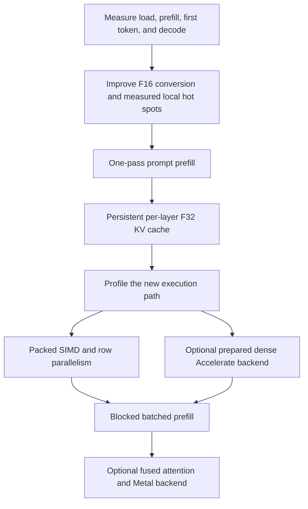

# Inference Optimization Roadmap

Prepared for review on 2026-10-16, after the first successful real-model text
generation. These are proposed changes, ranked from small local edits to major
backend and scheduling work. The ranking considers implementation difficulty,
correctness risk, and how much of this project must change.

**The largest structural opportunities are one-pass prefill and a persistent
KV cache.** They appear below several smaller changes because they are more
involved. Expected benefits are estimates from reading the code, not measured
speedups. A profiler may change the order within each difficulty group.

## Current baseline

The engine runs Qwen2.5-0.5B-Instruct with packed Q5_0, Q8_0, Q4_K, and Q6_K
weights, F32 activations, and greedy sampling. The local model uses 24 layers,
896 model dimensions, 4,864 FFN dimensions, 14 query heads, 2 KV heads, and
64 dimensions per head. These values are recorded in [PROJECT_GUIDE.md](../PROJECT_GUIDE.md).

The complete real CLI smoke test took **729.23 seconds**, producing
`The capital of France is Paris.` That is a previous correctness-test duration,
not an isolated, repeated performance benchmark or a profile of individual
functions. All 23 checks passed with the local model configured.

Code observations that motivate this list:

- [app.cpp](../src/app.cpp) forwards every prompt token separately.
- [qwen2_forward_token](../src/qwen2_architecture.cpp) rebuilds embeddings and
  every layer's activations for the entire prefix on every call. The plural
  `keys` and `values` arrays are reused as temporary workspace for each layer;
  they are not a persistent cache for all layers.
- [quantization.cpp](../src/quantization.cpp) converts F16 block scales with
  arithmetic including `powf` and `ldexpf`, repeatedly during packed products.
- [transformer_ops.cpp](../src/transformer_ops.cpp) computes RoPE powers and
  trigonometric values inside head loops. Attention computes its scale inside
  the token-score loop.
- [gguf_find_tensor](../src/gguf_reader.cpp) scans tensor names linearly. The
  forward helpers repeatedly format names, look up tensors, and construct views.
- The current local build is already **Release with `-O3`**. Enabling Release
  is a baseline check, not an unimplemented optimization here.
- The app starts its displayed generation timer **after prefill**. Its current
  tokens/s figure does not describe the wait for the first output token.

## Before optimizing: make the measurements useful

Add or collect separate timings for model/tokenizer loading, prompt formatting
and tokenization, prefill, first output, and later token forwards. Record
formatted prompt token count, generated token count, EOS behavior, and memory
alongside the timing. Time to first token should mean the first actual generated
piece, not the immediately printed `Output:` heading.

Use the same model, prompt IDs, context length, and CPU/thread settings when
comparing versions. Separate cold runs from warm runs; report repeated-run
medians and variation. Record a fixed token history for backend comparisons so
an early EOS or a different answer does not silently reduce the workload.

Profile a representative forward call and distinguish time in packed dot
products, scale conversion, attention, RoPE, and metadata lookup. Start with
small kernel measurements and short histories. Reserve the full slow CLI check
for meaningful integration checkpoints. Better timing is measurement work;
it does not itself make inference faster.

## Ranked shortlist

Difficulty is relative: **small** changes stay inside one helper; **medium**
changes affect several helpers or ownership; **large** changes affect state,
numerical kernels, or parallel execution; **very large** changes add a backend
or a request scheduler. Items at similar difficulty can be reordered after profiling.

| Rank | Proposed optimization | Difficulty | Main benefit | Expected return here |
| --- | --- | --- | --- | --- |
| 1 | Replace arithmetic F16 scale conversion | Small | Cheaper packed block processing | Promising local candidate; profile first |
| 2 | Hoist constant calculations and repeated divisions | Small | Less work inside scalar loops | Small, compiler-dependent |
| 3 | Try LTO and inspect compiler vectorization | Small–medium | Better optimization across source files | Uncertain; inexpensive experiment |
| 4 | Remove extra bias/residual copy passes | Small–medium | Less activation memory traffic | Small while matvec/recomputation dominate |
| 5 | Precompute RoPE frequencies and reuse sine/cosine | Small–medium | Fewer repeated math-library calls | Local improvement, especially before caching |
| 6 | Cache validated tensor views at model load | Medium | Avoid name scans and repeated shape work | Useful cleanup; probably secondary to model math |
| 7 | Specialize packed matvec dispatch and scalar kernels | Medium | Less per-block branching and unpacking overhead | Potentially useful in hot kernels |
| 8 | Evaluate the prompt once during prefill | Medium | Eliminate repeated prompt-prefix evaluation | Very high structural potential for first output |
| 9 | Optionally decode selected weights once and use Accelerate | Medium–large | Exchange RAM/startup work for dense kernels | Experimental alternative; can increase bandwidth cost |
| 10 | Add a persistent per-layer KV cache | Large | Compute each new token's layers once | Very high structural potential for decode |
| 11 | Add ARM SIMD packed dot/matvec kernels | Large | Process more weights per instruction | High potential if packed kernels dominate |
| 12 | Parallelize independent matrix rows | Large | Use multiple CPU cores | Potentially high; bounded by bandwidth and overhead |
| 13 | Use blocked matrix-matrix products for batched prefill | Large–very large | Reuse weight tiles across prompt positions | High potential for longer prompts |
| 14 | Store KV cache at reduced precision | Large–very large | Reduce cache RAM and memory reads | Most useful at long context; introduces rounding |
| 15 | Tile/fuse attention with online softmax | Very large | Reduce attention memory traffic | More relevant after batched prefill or GPU work |
| 16 | Build a Metal GPU execution backend | Very large | Accelerate the actual model's numerical work | High potential, substantial implementation effort |
| 17 | Shared prefixes, paged KV, and continuous batching | Very large | Improve multi-request reuse and throughput | Low immediate value for this single-request CLI |
| 18 | Speculative decoding | Very large | Verify several proposed tokens per target pass | Uncertain for this small model; requires earlier work |

## 1. Replace arithmetic F16 scale conversion

**Where:** `f16_bits_to_f32` in [quantization.cpp](../src/quantization.cpp).

Use a portable conversion based on the floating-point bit representation, or a
supported hardware conversion behind a portable fallback. This removes the
need to express sign and exponent reconstruction through general math calls.
The helper is shared by all packed formats, so a local improvement reaches
many matrix products. Inspect generated code or profile it first: source-level
calls do not prove that the compiler leaves every operation in the executable.

**Validate:** all 65,536 F16 bit patterns against an independent conversion
reference, including signed zero, subnormals, infinities, and NaNs. Compare NaN
classification rather than requiring an arbitrary payload. Run all existing
block-decoding and dot-product checks. Keep the documented conversion semantics.

## 2. Hoist constants and repeated divisions

**Where:** attention in [transformer_ops.cpp](../src/transformer_ops.cpp) and
RMSNorm in [tensor.cpp](../src/tensor.cpp).

Calculate `1 / sqrt(head_dimension)` outside the attention score loop. Compute
one reciprocal of the RMSNorm denominator and multiply by it across the
vector. Check compiler output before keeping a rewrite; some invariant work
may already be hoisted automatically.

**Validate:** numerical helper tests and forward logits. Replacing division
with multiplication by a reciprocal can change rounding. Keep finite-value
checks and stable softmax behavior intact.

## 3. Try LTO and inspect vectorization

**Where:** [CMakeLists.txt](../CMakeLists.txt) and compiler diagnostics for the
project's tensor and quantization translation units.

Experiment with supported interprocedural optimization/LTO so the compiler can
optimize across source files, for example between the matvec loops and block
dot helpers. Inspect successful and missed vectorization reports. Keep CPU
target tuning optional so a binary built for one machine remains clearly
distinguished from a portable build. These mechanisms are described in
[Clang ThinLTO](https://clang.llvm.org/docs/ThinLTO.html) and
[LLVM vectorization documentation](https://llvm.org/docs/Vectorizers.html).

**Validate:** identical benchmark inputs and the complete numerical suite.
Avoid making global `-ffast-math` the shortcut: its assumptions about non-finite
values conflict with the engine's explicit NaN/Inf rejection contract.
See the [Clang floating-point options](https://clang.llvm.org/docs/UsersManual.html#controlling-floating-point-behavior).

## 4. Remove extra bias and residual copy passes

**Where:** `qwen2_layer_project` and the attention/FFN residual updates in
[qwen2_architecture.cpp](../src/qwen2_architecture.cpp).

Bias addition currently writes a temporary vector and then copies it to the
projection buffer. Residual addition also writes scratch before copying back
to the activation. Dedicated internal operations with an explicit in-place
contract can remove those extra passes. Fuse bias application into a projection
epilogue later if the kernel interface makes that natural.

**Validate:** preserve the public tensor helpers' existing aliasing contracts;
do not silently allow unsupported overlap. Compare projection, residual, and
forward results. SwiGLU already combines SiLU and multiplication, so that
particular fusion is already present.

## 5. Precompute and reuse RoPE values

**Where:** `rotate_array_helper` and Qwen model/state initialization.

Compute frequency values once for the model configuration. Compute each
position's sine/cosine pairs once and reuse them across Q and K heads and
layers. Reuse across later full-prefix calls as well while that path remains.
A bounded state table can be allocated at initialization; do not add allocations
to token forward. For this model, a full F32 sine/cosine table for 32,768
positions and 32 frequency pairs would occupy 8 MiB.

**Validate:** split-half pairing, positions beyond zero, correct frequency base,
context limits, and model-specific ownership. Keep a direct formula as a
reference for comparisons; numerical differences in angles can affect logits.

## 6. Cache validated tensor views at load time

**Where:** Qwen's currently unused `architecture_data`, configuration/destruction
callbacks, and the layer lookup/projection helpers.

Store a Qwen-specific weight table containing validated norm/bias vectors and
F32 or packed matrix views. The forward path then uses indexed layer data rather
than `snprintf`, linear string scans, and repeated view construction. The generic
engine still owns the mapping; cached views borrow it and must be destroyed
before the mapping is released.

**Validate:** missing/malformed tensors still fail on load, partial-load cleanup
works, and multiple model lifetimes cannot reuse stale pointers. Some current
fixtures mutate tensor metadata after initialization to force a late failure.
If views become immutable cached descriptors, adapt that injection point while
retaining an independent late-failure/retry test and malformed-load coverage.

## 7. Specialize packed dispatch and scalar block loops

**Where:** [quantized_matvec.cpp](../src/quantized_matvec.cpp) and Q5_0/Q8_0/
Q4_K/Q6_K dot helpers in [quantization.cpp](../src/quantization.cpp).

Select a format-specific loop once per matrix operation rather than expressing
a format switch for every block. Simplify Q5_0 unpacking in groups where that
avoids per-element selection. Profile separate unpacking, scale conversion,
and accumulation costs before adding more specialized code. The compiler may
already move some branches; measurement decides whether a rewrite earns its cost.

**Validate:** all four formats, rectangular shapes, multiple blocks per row,
unaligned storage, input/output guards, and mixed-weight logits. Preserve safe
loads: a mapped tensor base does not make every packed block aligned. Existing
direct packed dot products already avoid decoding complete matrices per call.

## 8. Evaluate the prompt once

**Where:** the app prefill loop, a new shared engine/architecture prefill entry
point, and the full-prefix evaluation schedule.

The app needs logits only after the complete prompt. Today it evaluates the
prefix of length 1, then 2, and so on through the prompt length `P`. Add a checked
prefill operation that accepts the prompt IDs and evaluates the complete causal
prefix once. Keep model-private history management behind the engine interface.
This can initially reuse scalar matvecs and existing full-prefix workspace.

The projection/FFN work, counted in evaluated token positions, changes from
`P * (P + 1) / 2` to `P`. For an illustrative 40-token formatted prompt, that is
820 position evaluations versus 40. This is a work count, **not a promised
20.5× wall-clock speedup**. Repeated attention work is also eliminated.
The final normalization and vocabulary projection also run once rather than
once for every prompt token.

**Validate:** final logits and committed history match sequential reference
prefill for every tested prefix; only final prompt logits are used; invalid
IDs and exhausted context are rejected; failure does not partially commit
history. Update app contract tests to cover the new prefill API.

This improves time to first output. Later generated-token calls still recompute
their prefixes until item 10 is implemented. It is separate from the matrix-matrix
batching in item 13.

## 9. Optional: decode selected weights once and use Accelerate

**Where:** model-owned prepared weights and an optional dense numerical backend.

Try decoding selected frequently used matrices once at load time, then using
optimized dense F32 operations. Apple's Accelerate exposes standard dense
matrix/vector and matrix/matrix BLAS operations; see its
[BLAS documentation](https://developer.apple.com/documentation/accelerate/blas-library).
The packed GGUF formats need explicit conversion; they cannot be passed to a
normal F32 BLAS call as raw bytes.

**Tradeoff:** a dense copy costs `4 * element_count` bytes, in addition to any
retained mapped data and workspace. One local vocabulary projection alone has
`151936 * 896` values, about **519 MiB** in F32. Calculate the full budget from
the actual tensor directory, including stored duplicate/tied weights, rather
than estimating from the model's marketing size. Dequantization costs startup
time, and expanded weights can make decode more bandwidth-bound.

**Validate:** numerical parity, load time, peak memory, and both prefill/decode
latency. Treat this as an alternative to spending effort on packed CPU kernels,
not an automatic prerequisite. Enabling llama.cpp's BLAS flag alone does not
accelerate the project's own layer execution.

## 10. Add a persistent per-layer KV cache

**Where:** `Qwen2InferenceState`, state initialization/destruction, and the Qwen
forward schedule. This changes the documented full-prefix implementation contract.

Store K and V for **every layer and every committed position**, and process only
the new token's embedding, Q/K/V, attention output, and FFN on a decode call.
Attention for that token reads earlier cached K/V. Store keys after RoPE and
values without RoPE. The existing temporary arrays cannot simply be relabeled
as the cache: they currently hold only one layer's data at a time.

Projection and FFN work becomes one position per appended token instead of the
whole prefix. Attention for one new token still reads the prior context; its
cost is not constant as context grows.

For this local model, an F32 cache needs:

```text
2 (K and V) * 24 layers * context * 2 KV heads * 64 head dimensions * 4 bytes
= 24 KiB per context position
= 768 MiB at 32,768 positions
```

Allocate for the requested context, with checked arithmetic and memory limits.
Use the KV-head count, not the query-head count. Old full-prefix activation
workspace may be reduced for decode, although batched prefill needs its own
bounded workspace.

**Validate:** compare every vocabulary logit with the retained full-prefix
reference at successive positions, multiple layers, GQA, and longer histories.
Check model/state matching, causal visibility, context boundaries, and two
independent inference states. Commit position only after the whole new token
succeeds; failed/retried calls must not expose partial cache entries as history.

## 11. Add ARM SIMD kernels

**Where:** optional CPU kernel implementations behind the current numerical API.

Vectorize unpacking and dot accumulation, starting with a simple packed type
such as Q8_0 before Q5_0 and the K formats. Add the required CPU-feature checks
and retain scalar fallbacks. Inspect compiler vectorization first; manual SIMD
should target work that remains expensive after the earlier changes.

**Validate:** tails, unaligned data, all quantized types, extreme values, and
the full forward reference. Vector reductions/FMA can change accumulation
rounding. Compare logits with justified tolerances and inspect close greedy
ties; readable output alone is not enough evidence.

## 12. Parallelize matrix rows

**Where:** matrix-vector execution and inference workspace/thread ownership.

Rows of a matrix-vector product have independent output values. Partition
contiguous row ranges among a persistent, bounded worker pool; avoid starting
threads for each row or each token. Allocate worker state during initialization.
Keep small operations serial, and measure thread counts rather than assuming
all logical cores are best.

**Validate:** disjoint output writes, synchronized completion, deterministic
error propagation, and thread-safe use of model views. Run race checks as well
as numerical tests. Measure memory-bandwidth saturation and avoid nested worker
pools when a library backend already owns its own threads.

## 13. Use blocked matrix-matrix products for prefill

**Where:** the prefill schedule and new batched projection kernels.

Process multiple prompt positions as an activation matrix. Reuse a weight tile
across those positions rather than streaming the whole matrix again for every
matvec. Begin with bounded chunks so long prompts do not require unbounded
intermediate buffers. This can use a prepared dense BLAS backend or custom
packed matrix-matrix kernels; the two approaches have different memory costs.

**Dependencies:** a correct one-pass prefill API, clear position handling, and
a defined way to populate persistent K/V when item 10 is enabled.

**Validate:** chunk boundaries, causal masking within a chunk, GQA, RoPE positions,
final prompt logits, and subsequent cached decode against the scalar reference.
Batching prompt positions is distinct from batching independent user requests.

## 14. Reduce KV-cache precision

**Where:** cache storage and attention reads, after F32 cached decode is correct.

Store K/V as F16, or later use a separately designed quantized cache with scales.
For this model's full context, F16 halves the calculated F32 cache from 768 MiB
to 384 MiB. An 8-bit payload would be 192 MiB before scale/metadata overhead.
Those are storage calculations, not throughput forecasts.

**Validate:** long-context logits, greedy behavior, conversion overhead, and
memory use. Cache quantization is a separate internal representation from the
GGUF weight formats; it introduces additional numerical error. Include the cost
of converting cache values for attention when judging the result.

## 15. Tile and fuse attention

**Where:** batched attention kernels, especially alongside a future GPU backend.

Use tiling and online softmax to limit intermediate memory traffic and combine
score, normalization, and value accumulation work. The approach is motivated
by [FlashAttention](https://arxiv.org/abs/2205.14135); its published GPU results
are not speedup predictions for this scalar CPU implementation.

The current single-query helper already stores only a score vector per head,
not a full context-by-context matrix. Do not justify this item by claiming
that the current code materializes a quadratic attention matrix. The larger
opportunity appears when adding batched prefill or GPU attention.

**Validate:** numerically stable online normalization, causal tile boundaries,
GQA, and outputs across short/long sequences. Preserve a simple attention
reference to diagnose numerical and indexing errors.

## 16. Build a Metal backend

**Where:** new GPU numerical kernels, resource ownership, and dispatch code.

Keep model weights and K/V available to the GPU across token steps, implement
or convert the packed weight formats, and move projections, attention, and FFN
work onto it. Manage command scheduling, synchronization, and CPU-visible
logits without unnecessary round trips. Apple's
[Metal compute introduction](https://developer.apple.com/documentation/metal/performing-calculations-on-a-gpu)
describes the compute execution model.

**Validate:** per-operation and complete-prefix/cached logits against CPU,
resource lifetime, partial failures, and supported hardware. Measure both
startup overhead and sustained generation. This requires the project's own
backend: turning `GGML_METAL` on for the vocabulary-only llama.cpp dependency
will not move this engine's transformer execution to the GPU.

## 17. Add multi-request reuse and scheduling

**Where:** a future long-lived engine with multiple requests, rather than the
current one-shot CLI.

Cache exact shared prompt prefixes with matching model/position settings; use
paged K/V storage and bounded eviction to manage many contexts; and schedule
active requests together. Build a fixed cache/page budget rather than allowing
memory to grow with every request.

**Validate:** independent histories, correct cache identity, eviction, failure
recovery, fairness, and per-request latency as well as total throughput. This
is a separate product direction. It offers little benefit while each CLI run
loads a model for one independent request and then exits.

## 18. Add speculative decoding

**Where:** a future decode scheduler with a cheap proposal mechanism and target
verification over multiple tokens.

Generate proposed tokens cheaply, verify them with the target model, and retain
only the accepted prefix. Greedy verification must agree with the target's
greedy choice at every accepted position. Distribution-preserving stochastic
speculation needs its own correct acceptance procedure; see the original
[speculative decoding paper](https://arxiv.org/abs/2211.17192).

**Dependencies:** fast cached decode, efficient verification/prefill, and robust
cache rollback. A small target model may leave too little room for a second
model or proposal mechanism to pay for itself.

**Validate:** target-output equivalence, rejected-draft cache handling, EOS,
context limits, acceptance rate, added memory, and total time including proposal
work. Never equate a high draft acceptance rate with an actual speedup.

## Suggested implementation path

Start with measurement and item 1. Try the small local changes where profiling
supports them, but prioritize **item 8: one-pass prefill** before spending much
time on small copy/lookup improvements. Next, implement **item 10: an F32 KV
cache**, keeping the existing full-prefix path as the correctness reference.

Then profile again. Choose packed SIMD/row parallelism if packed CPU kernels
dominate, or investigate the dense Accelerate alternative if the RAM budget
allows. Add blocked prefill after the basic schedule is correct. Treat a Metal
backend as a separate larger milestone. Multi-request scheduling and speculation
can wait for a concrete need beyond this CLI.



## Acceptance for each optimization

Keep a selectable scalar/full-prefix reference while optimized execution is
introduced. For behavior-preserving changes, compare every logit at the same
token positions. For changes in reduction order, define and justify numerical
tolerances; for reduced precision, explicitly evaluate the added error.
Retain malformed-model, finite-value, failure/retry, and cleanup coverage.

Run the relevant existing kernel tests first, then the F32/mixed-weight forward
and app contracts. Add targeted cache/prefill/parallel tests when those features
are implemented. Use the actual GGUF for final acceptance after substantive
schedule/kernel changes. The existing suite and commands are documented in the
[first-text roadmap](roadmap-to-generated-text.md).

Record each candidate in this form before deciding to keep it:

| Change | Reference version | Prompt/history length | Load | Prefill | First token | Later-token latency | Memory | Logit comparison | Decision |
| --- | --- | --- | --- | --- | --- | --- | --- | --- | --- |
| Candidate | Baseline identifier | Fixed workload | Measured | Measured | Measured | Measured | Measured | Pass/error details | Keep or discard |

Avoid measuring the cost of creating benchmark inputs inside a timed kernel
loop. Keep model data identical; do not count a shorter prompt, a different
quantization, an earlier EOS, or less text as a transparent implementation speedup.
