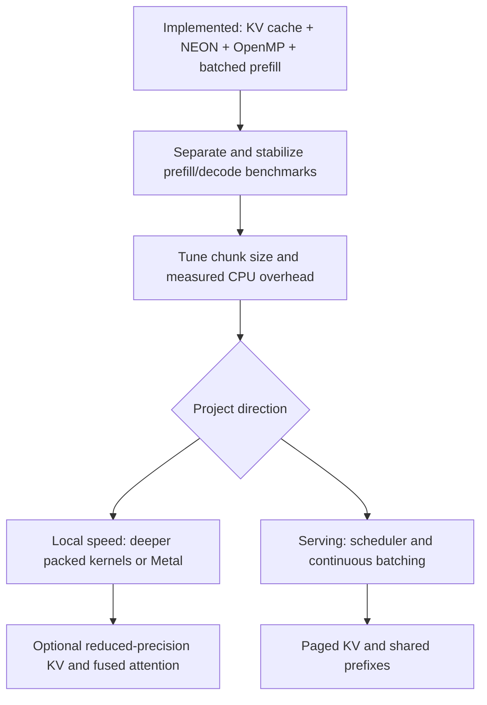

# Inference Optimization Roadmap

This is now a living implementation-status document rather than only a list of
proposals. The engine has crossed several of the original structural milestones:
persistent per-layer K/V caching, ARM NEON packed kernels, OpenMP row
parallelism, skipped intermediate prompt logits, and bounded batched prefill.
Items still need controlled cold/warm benchmarks before their speedups should be
claimed. The remaining rankings describe likely next work, not a fixed order.

## Current baseline

The engine runs Qwen2.5-0.5B-Instruct with packed Q5_0, Q8_0, Q4_K, and Q6_K
weights, F32 activations, and greedy sampling. The local model uses 24 layers,
896 model dimensions, 4,864 FFN dimensions, 14 query heads, 2 KV heads, and
64 dimensions per head. These values are recorded in [PROJECT_GUIDE.md](../PROJECT_GUIDE.md).

The old 729.23-second first-generation smoke test is historical and no longer
describes the active execution path. The current implementation has:

- a checked `engine_prefill_tokens` API and Qwen2 layer-first chunks of up to
  eight prompt positions;
- batched F32 and packed Q5_0/Q8_0/Q4_K/Q6_K weight projections during prefill;
- per-position RoPE, causal attention, and K/V writes to the same persistent
  cache consumed by decode;
- single-token cached decode, with the retained full-prefix implementation used
  as a small-fixture correctness reference;
- ARM64 NEON packed block-dot kernels with scalar fallbacks, plus OpenMP over
  independent matrix rows;
- native ARM FP16-to-F32 scale conversion with a portable bit-expansion fallback;
- operation and per-weight-format profiling, a standalone packed-matvec
  benchmark, time-to-first-token reporting, generation throughput, CPU use, and
  resident-memory reporting. The current automated suite has 22 checks; real
  GGUF runs remain a manual acceptance step.

Current observations that still motivate work:

- layer projections and the vocabulary output projection dominate measured CPU
  time; scalar attention has been a small share on tested short contexts;
- [gguf_find_tensor](../src/gguf_reader.cpp) still scans tensor names linearly,
  and forward helpers still format names and reconstruct validated views;
- RoPE still computes powers and trigonometric values in the forward path;
- batched prefill reuses one aligned packed block across a chunk but invokes the
  existing format dot operation for each activation; further block-level batch
  reuse is possible only if measurement justifies the extra kernel complexity;
- the local build is already Release with `-O3`; four OpenMP workers performed
  best in the initial M2 thread-count experiment, but controlled repeated
  benchmarks remain necessary.

## Measurement status and remaining gaps

The CLI now reports time to first emitted token separately from generation-only
tokens/s, CPU use, and resident RAM. `--profile` reports operation stages and
F32/Q5_0/Q8_0/Q4_K/Q6_K kernel time/calls. The standalone packed benchmark is
useful for before/after kernel comparisons. Profiling still combines prefill and
decode, and a batched prefill call represents multiple positions, so its call
counts cannot be compared directly with the older per-token path.

Still add or collect separate timings for model/tokenizer loading, prompt
formatting and tokenization, prefill, first output, and later token forwards.
Record formatted prompt token count, generated token count, EOS behavior, and memory
alongside the timing. Time to first token should mean the first actual generated
piece, not the immediately printed `Output:` heading.

Use the same model, prompt IDs, context length, and CPU/thread settings when
comparing versions. Separate cold runs from warm runs; report repeated-run
medians and variation. Record a fixed token history for backend comparisons so
an early EOS or a different answer does not silently reduce the workload.

Profile a representative forward call and distinguish time in packed dot
products, scale conversion, attention, RoPE, and metadata lookup. Start with
small kernel measurements and short histories. Reserve the full slow CLI check
for meaningful integration checkpoints. Better timing is measurement work;
it does not itself make inference faster.

## Ranked shortlist

Difficulty is relative: **small** changes stay inside one helper; **medium**
changes affect several helpers or ownership; **large** changes affect state,
numerical kernels, or parallel execution; **very large** changes add a backend
or a request scheduler. Items at similar difficulty can be reordered after profiling.

| Rank | Optimization | Status | Difficulty | Main benefit / next decision |
| --- | --- | --- | --- | --- |
| 1 | Replace arithmetic F16 scale conversion | **Implemented** | Small | Native ARM conversion plus portable fallback; end-to-end gain was inconclusive |
| 2 | Hoist constant calculations and repeated divisions | Planned | Small | Small compiler-dependent cleanup; profile first |
| 3 | Try LTO and inspect compiler vectorization | Planned | Small–medium | Inexpensive experiment after stable benchmarks |
| 4 | Remove extra bias/residual copy passes | **Partial** | Small–medium | Batched epilogues update in place; single-token helper still has copies |
| 5 | Precompute RoPE frequencies and sine/cosine | Planned | Small–medium | Remove repeated power/trigonometry work |
| 6 | Cache validated tensor views at model load | Planned | Medium | Remove name scans, formatting, and repeated view validation |
| 7 | Specialize packed dispatch/block loops | **Partial** | Medium | NEON kernels exist; matrix loops still have format dispatch/block overhead |
| 8 | Add a checked one-pass prefill API and skip unused logits | **Implemented** | Medium | Whole prompt submitted once; only final prompt position produces logits |
| 9 | Optionally decode selected weights once/use Accelerate | Experimental | Medium–large | Trade RAM/startup for dense kernels; not implemented |
| 10 | Add a persistent per-layer KV cache | **Implemented** | Large | Decode computes only the newly appended token |
| 11 | Add ARM SIMD packed dot/matvec kernels | **Implemented** | Large | NEON for Q5_0/Q8_0/Q4_K/Q6_K, scalar fallback retained |
| 12 | Parallelize independent matrix rows | **Implemented** | Large | OpenMP row parallelism; four workers currently preferred on the M2 |
| 13 | Add bounded batched prefill projections | **Implemented; tune** | Large–very large | Layer-first chunks of eight; measure/tune block reuse and chunk size |
| 14 | Store KV cache at reduced precision | Planned | Large–very large | Reduce long-context memory and cache bandwidth |
| 15 | Tile/fuse attention with online softmax | Planned | Very large | More relevant for long context or GPU execution |
| 16 | Build a Metal GPU execution backend | Planned | Very large | Highest hardware upside, substantial backend work |
| 17 | Shared prefixes, paged KV, continuous batching | Future serving track | Very large | Multi-user throughput/memory management, not single-request tok/s |
| 18 | Speculative decoding | Future | Very large | Requires fast verification and robust cache rollback |

## 1. Replace arithmetic F16 scale conversion — implemented

**Where:** `f16_bits_to_f32` in [quantization.cpp](../src/quantization.cpp).

ARM64 uses the compiler-supported native `__fp16` conversion, and other targets
use portable IEEE-754 bit expansion. This removed the original `powf`/`ldexpf`
reconstruction. It did not produce a reliable end-to-end tok/s improvement in
short runs, so keep it as a correct low-overhead primitive rather than claiming
it solved packed-matvec performance.
The helper is shared by all packed formats, so a local improvement reaches
many matrix products. Inspect generated code or profile it first: source-level
calls do not prove that the compiler leaves every operation in the executable.

**Validated:** all 65,536 F16 bit patterns against an independent arithmetic
reference, including signed zero, subnormals, infinities, and NaNs, plus the
existing block-decoding, dot-product, and mixed-forward checks.

## 2. Hoist constants and repeated divisions

**Where:** attention in [transformer_ops.cpp](../src/transformer_ops.cpp) and
RMSNorm in [tensor.cpp](../src/tensor.cpp).

Calculate `1 / sqrt(head_dimension)` outside the attention score loop. Compute
one reciprocal of the RMSNorm denominator and multiply by it across the
vector. Check compiler output before keeping a rewrite; some invariant work
may already be hoisted automatically.

**Validate:** numerical helper tests and forward logits. Replacing division
with multiplication by a reciprocal can change rounding. Keep finite-value
checks and stable softmax behavior intact.

## 3. Try LTO and inspect vectorization

**Where:** [CMakeLists.txt](../CMakeLists.txt) and compiler diagnostics for the
project's tensor and quantization translation units.

Experiment with supported interprocedural optimization/LTO so the compiler can
optimize across source files, for example between the matvec loops and block
dot helpers. Inspect successful and missed vectorization reports. Keep CPU
target tuning optional so a binary built for one machine remains clearly
distinguished from a portable build. These mechanisms are described in
[Clang ThinLTO](https://clang.llvm.org/docs/ThinLTO.html) and
[LLVM vectorization documentation](https://llvm.org/docs/Vectorizers.html).

**Validate:** identical benchmark inputs and the complete numerical suite.
Avoid making global `-ffast-math` the shortcut: its assumptions about non-finite
values conflict with the engine's explicit NaN/Inf rejection contract.
See the [Clang floating-point options](https://clang.llvm.org/docs/UsersManual.html#controlling-floating-point-behavior).

## 4. Remove extra bias and residual copy passes — partially implemented

**Where:** `qwen2_layer_project` and the attention/FFN residual updates in
[qwen2_architecture.cpp](../src/qwen2_architecture.cpp).

The single-token `qwen2_layer_project` path still writes a temporary vector and
copies it to the projection buffer. Its residual additions also use scratch.
The batched prefill path applies projection biases and residuals directly, so
this item now mainly concerns cached single-token decode. Dedicated internal
operations with an explicit in-place contract can remove those remaining passes.
Fuse bias application into a projection
epilogue later if the kernel interface makes that natural.

**Validate:** preserve the public tensor helpers' existing aliasing contracts;
do not silently allow unsupported overlap. Compare projection, residual, and
forward results. SwiGLU already combines SiLU and multiplication, so that
particular fusion is already present.

## 5. Precompute and reuse RoPE values

**Where:** `rotate_array_helper` and Qwen model/state initialization.

Compute frequency values once for the model configuration. Compute each
position's sine/cosine pairs once and reuse them across Q and K heads and
layers. Reuse across later full-prefix calls as well while that path remains.
A bounded state table can be allocated at initialization; do not add allocations
to token forward. For this model, a full F32 sine/cosine table for 32,768
positions and 32 frequency pairs would occupy 8 MiB.

**Validate:** split-half pairing, positions beyond zero, correct frequency base,
context limits, and model-specific ownership. Keep a direct formula as a
reference for comparisons; numerical differences in angles can affect logits.

## 6. Cache validated tensor views at load time

**Where:** Qwen's currently unused `architecture_data`, configuration/destruction
callbacks, and the layer lookup/projection helpers.

Store a Qwen-specific weight table containing validated norm/bias vectors and
F32 or packed matrix views. The forward path then uses indexed layer data rather
than `snprintf`, linear string scans, and repeated view construction. The generic
engine still owns the mapping; cached views borrow it and must be destroyed
before the mapping is released.

**Validate:** missing/malformed tensors still fail on load, partial-load cleanup
works, and multiple model lifetimes cannot reuse stale pointers. Some current
fixtures mutate tensor metadata after initialization to force a late failure.
If views become immutable cached descriptors, adapt that injection point while
retaining an independent late-failure/retry test and malformed-load coverage.

## 7. Specialize packed dispatch and block loops — partially implemented

**Where:** [quantized_matvec.cpp](../src/quantized_matvec.cpp) and Q5_0/Q8_0/
Q4_K/Q6_K dot helpers in [quantization.cpp](../src/quantization.cpp).

ARM64 format-specific NEON dot kernels are implemented, but the surrounding
matrix loops can still be specialized further. Select a format-specific loop
once per matrix operation rather than expressing
a format switch for every block. Simplify Q5_0 unpacking in groups where that
avoids per-element selection. Profile separate unpacking, scale conversion,
and accumulation costs before adding more specialized code. The compiler may
already move some branches; measurement decides whether a rewrite earns its cost.

**Validate:** all four formats, rectangular shapes, multiple blocks per row,
unaligned storage, input/output guards, and mixed-weight logits. Preserve safe
loads: a mapped tensor base does not make every packed block aligned. Existing
direct packed dot products already avoid decoding complete matrices per call.

## 8. Add a checked prefill API and skip unused logits — implemented

**Where:** [app.cpp](../src/app.cpp), [engine.cpp](../src/engine.cpp), the
architecture interface, and Qwen2 prefill scheduling.

`engine_prefill_tokens` now validates and submits the prompt as one operation.
The Qwen2 callback has transactional logical commit: invalid requests leave the
state untouched, and a processing failure hides attempted future K/V slots,
restores the old token count, invalidates logits, and permits retry. Only the
last prompt position runs final normalization and `output.weight`.

The active engine already had cached token execution by the time this API was
added, so the historical `P*(P+1)/2` full-prefix-work argument no longer applied.
The realized savings at this stage came from removing intermediate vocabulary
projections and establishing the contract needed by item 13.

**Validated:** final logits and K/V contents against sequential cached prefill,
invalid IDs/counts/capacity, late failure and retry, mixed quantization, chunk
boundaries, and decode immediately after prefill.

## 9. Optional: decode selected weights once and use Accelerate

**Where:** model-owned prepared weights and an optional dense numerical backend.

Try decoding selected frequently used matrices once at load time, then using
optimized dense F32 operations. Apple's Accelerate exposes standard dense
matrix/vector and matrix/matrix BLAS operations; see its
[BLAS documentation](https://developer.apple.com/documentation/accelerate/blas-library).
The packed GGUF formats need explicit conversion; they cannot be passed to a
normal F32 BLAS call as raw bytes.

**Tradeoff:** a dense copy costs `4 * element_count` bytes, in addition to any
retained mapped data and workspace. One local vocabulary projection alone has
`151936 * 896` values, about **519 MiB** in F32. Calculate the full budget from
the actual tensor directory, including stored duplicate/tied weights, rather
than estimating from the model's marketing size. Dequantization costs startup
time, and expanded weights can make decode more bandwidth-bound.

**Validate:** numerical parity, load time, peak memory, and both prefill/decode
latency. Treat this as an alternative to spending effort on packed CPU kernels,
not an automatic prerequisite. Enabling llama.cpp's BLAS flag alone does not
accelerate the project's own layer execution.

## 10. Add a persistent per-layer KV cache — implemented

**Where:** `Qwen2InferenceState`, state initialization/destruction, and the Qwen
cached forward schedule.

K and V are stored for every layer and committed position in
`[layer][position][KV head][head dimension]` order. Keys are cached after RoPE;
values are cached without RoPE. Decode processes only the new token's embedding,
Q/K/V, attention output, and FFN, while attention reads prior cached K/V.
Projection and FFN work is therefore one position per generated token. Attention
still reads a growing history, so long-context decode is not constant-cost.

For this local model, an F32 cache needs:

```text
2 (K and V) * 24 layers * context * 2 KV heads * 64 head dimensions * 4 bytes
= 24 KiB per context position
= 768 MiB at 32,768 positions
```

Allocation uses the requested context and checked arithmetic, based on KV-head
rather than query-head count. Batched prefill has separate bounded chunk scratch.
The retained full-prefix fixture validates cached logits at successive positions;
additional long-context and multi-state stress coverage remains worthwhile.
Failed/retried calls do not expose partial future slots through the committed
position count.

## 11. Add ARM SIMD kernels — implemented

**Where:** packed dot helpers in [quantization.cpp](../src/quantization.cpp).

ARM64 NEON implementations now cover Q5_0, Q8_0, Q4_K, and Q6_K unpacking and
dot accumulation; non-ARM builds retain scalar fallbacks. Vector reductions can
change accumulation order, so forward tests use justified tolerances. The
[NEON guide](quantized-neon-beginners-guide.md) documents the implementation.
Further work should be driven by per-format real-model timing rather than adding
intrinsics indiscriminately.

**Validated:** unaligned packed storage, all supported quantized types,
reference block math, and mixed/full forward paths with numerical tolerances.
Future kernel changes must continue to inspect close greedy ties; readable
output alone is not enough evidence.

## 12. Parallelize matrix rows — implemented with OpenMP

**Where:** F32 and packed matrix-vector/matrix-batch execution.

Independent output rows use static OpenMP scheduling. Thread-count experiments
on the M2 found four workers faster than 2, 6, or 8 for the tested workload.
This is not a persistent custom worker pool, so OpenMP region overhead and
small-operation thresholds remain possible follow-up work. Avoid nested worker
pools if a future library backend owns its own threads.

**Validated:** disjoint output writes, synchronized completion, numerical
parity, and worker-failure propagation with multiple thread counts. Race tooling,
memory-bandwidth saturation measurements, and small-operation thresholds remain
useful follow-up work.

## 13. Use bounded matrix-batch products for prefill — implemented; tune next

**Where:** Qwen2 prefill scheduling, [tensor.cpp](../src/tensor.cpp), and
[quantized_matvec.cpp](../src/quantized_matvec.cpp).

Prompt positions are processed layer-first in chunks of up to eight. Q/K/V,
attention-output, and FFN projections accept token-major activation batches for
F32 and Q5_0/Q8_0/Q4_K/Q6_K weights. Each aligned packed block is loaded once
for an output row/block and applied across the chunk through existing
format-specific dot kernels. Scratch is allocated once during state creation.

Each token receives RoPE at its absolute position. The chunk's K/V entries are
written to the persistent cache before attention; each query passes only
`position+1` visible entries, so later positions in the chunk remain causally
invisible. Attention itself still runs one query position at a time and does not
materialize a full prompt-by-prompt score matrix. Only the final prompt position
produces vocabulary logits; decode stays on the single-token NEON path.

**Validated:** batch-kernel reference results, exact and non-exact chunk tails,
causal/GQA behavior through the forward fixture, K/V and final-logit parity,
late-failure rollback, mixed formats, and subsequent cached decode. Next measure
chunk sizes and consider deeper unpack reuse only if it produces repeatable TTFT
improvement over run-to-run and cold/warm variation. Batching prompt positions
remains distinct from batching independent user requests.

## 14. Reduce KV-cache precision

**Where:** cache storage and attention reads, now that F32 cached decode is correct.

Store K/V as F16, or later use a separately designed quantized cache with scales.
For this model's full context, F16 halves the calculated F32 cache from 768 MiB
to 384 MiB. An 8-bit payload would be 192 MiB before scale/metadata overhead.
Those are storage calculations, not throughput forecasts.

**Validate:** long-context logits, greedy behavior, conversion overhead, and
memory use. Cache quantization is a separate internal representation from the
GGUF weight formats; it introduces additional numerical error. Include the cost
of converting cache values for attention when judging the result.

## 15. Tile and fuse attention

**Where:** batched attention kernels, especially alongside a future GPU backend.

Use tiling and online softmax to limit intermediate memory traffic and combine
score, normalization, and value accumulation work. The approach is motivated
by [FlashAttention](https://arxiv.org/abs/2205.14135); its published GPU results
are not speedup predictions for this scalar CPU implementation.

The current single-query helper already stores only a score vector per head,
not a full context-by-context matrix. Do not justify this item by claiming
that the current code materializes a quadratic attention matrix. The larger
opportunity is most likely at longer contexts, larger prefill chunks, or with GPU attention.

**Validate:** numerically stable online normalization, causal tile boundaries,
GQA, and outputs across short/long sequences. Preserve a simple attention
reference to diagnose numerical and indexing errors.

## 16. Build a Metal backend

**Where:** new GPU numerical kernels, resource ownership, and dispatch code.

**Status:** the dispatch seam exists. `src/matrix_backend.h` defines F32 and packed
matvec/matmul operations; the CPU backend wraps the current kernels and
`src/matrix_backend_gpu.cpp` is an empty, unavailable stub. Still open: Metal
kernels, device-resident weight/K/V ownership (the API currently passes host
pointers), and an explicit backend selection mechanism.

Keep model weights and K/V available to the GPU across token steps, implement
or convert the packed weight formats, and move projections, attention, and FFN
work onto it. Manage command scheduling, synchronization, and CPU-visible
logits without unnecessary round trips. Apple's
[Metal compute introduction](https://developer.apple.com/documentation/metal/performing-calculations-on-a-gpu)
describes the compute execution model.

**Validate:** per-operation and complete-prefix/cached logits against CPU,
resource lifetime, partial failures, and supported hardware. Measure both
startup overhead and sustained generation. This requires the project's own
backend: turning `GGML_METAL` on for the vocabulary-only llama.cpp dependency
will not move this engine's transformer execution to the GPU.

## 17. Add multi-request reuse and scheduling

**Where:** a future long-lived engine with multiple requests, rather than the
current one-shot CLI.

Cache exact shared prompt prefixes with matching model/position settings; use
paged K/V storage and bounded eviction to manage many contexts; and schedule
active requests together. Build a fixed cache/page budget rather than allowing
memory to grow with every request.

**Validate:** independent histories, correct cache identity, eviction, failure
recovery, fairness, and per-request latency as well as total throughput. This
is a separate product direction. It offers little benefit while each CLI run
loads a model for one independent request and then exits.

## 18. Add speculative decoding

**Where:** a future decode scheduler with a cheap proposal mechanism and target
verification over multiple tokens.

Generate proposed tokens cheaply, verify them with the target model, and retain
only the accepted prefix. Greedy verification must agree with the target's
greedy choice at every accepted position. Distribution-preserving stochastic
speculation needs its own correct acceptance procedure; see the original
[speculative decoding paper](https://arxiv.org/abs/2211.17192).

**Dependencies:** fast cached decode, efficient verification/prefill, and robust
cache rollback. A small target model may leave too little room for a second
model or proposal mechanism to pay for itself.

**Validate:** target-output equivalence, rejected-draft cache handling, EOS,
context limits, acceptance rate, added memory, and total time including proposal
work. Never equate a high draft acceptance rate with an actual speedup.

## Suggested next implementation path

The old path through prefill, KV caching, NEON, row parallelism, and batched
prefill is complete. First stabilize measurement: report prefill separately from
decode, benchmark fixed prompt IDs with alternating cold/warm runs, and tune the
prefill chunk size. Then remove measured decode overhead such as repeated tensor
lookup/view construction or copies. Precompute RoPE values if profiling confirms
its value at realistic contexts.

After those CPU cleanups, choose deliberately between two tracks:

- **single-user local speed:** evaluate deeper packed batch kernels, reduced-KV
  precision, or a Metal backend;
- **serving throughput:** introduce request ownership/scheduling, continuous
  batching, and only then paged/shared-prefix KV management.

Dense Accelerate remains an experiment constrained by the large F32 expansion
of quantized weights. Fused attention matters more at long context or on GPU;
short-context profiles currently point to projections, not attention.



## Acceptance for each optimization

Keep a selectable scalar/full-prefix reference while optimized execution is
introduced. For behavior-preserving changes, compare every logit at the same
token positions. For changes in reduction order, define and justify numerical
tolerances; for reduced precision, explicitly evaluate the added error.
Retain malformed-model, finite-value, failure/retry, and cleanup coverage.

Run the relevant existing kernel tests first, then the F32/mixed-weight forward
and app contracts. Add targeted cache/prefill/parallel tests when those features
are implemented. Use the actual GGUF for final acceptance after substantive
schedule/kernel changes. The existing suite and commands are documented in the
[first-text roadmap](roadmap-to-generated-text.md).

Record each candidate in this form before deciding to keep it:

| Change | Reference version | Prompt/history length | Load | Prefill | First token | Later-token latency | Memory | Logit comparison | Decision |
| --- | --- | --- | --- | --- | --- | --- | --- | --- | --- |
| Candidate | Baseline identifier | Fixed workload | Measured | Measured | Measured | Measured | Measured | Pass/error details | Keep or discard |

Avoid measuring the cost of creating benchmark inputs inside a timed kernel
loop. Keep model data identical; do not count a shorter prompt, a different
quantization, an earlier EOS, or less text as a transparent implementation speedup.
