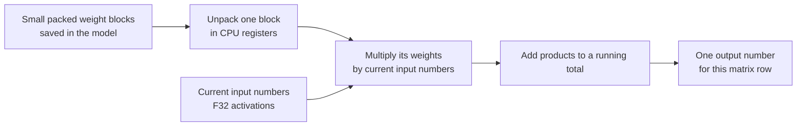

# Making quantized matrix–vector multiplication faster with NEON

This guide explains the project's Q5_0, Q8_0, Q4_K, and Q6_K CPU optimizations **from scratch**. Start with the non-technical explanation; the later sections connect it to the code and show how to test it. No SIMD background is required.

## The short version, without technical jargon

To choose its next piece of text, the model repeatedly combines a great many numbers. Its stored numbers (called **weights**) are packed tightly to save memory, a little like storing clothes in vacuum bags. Before using them, the computer must unpack them.

Imagine a worker doing this one number at a time: take one out, adjust it using its label, multiply it by another number, and add the answer to a running total. **NEON** is a feature of ARM processors, including Apple Silicon, that lets the worker handle several numbers together. The clothes stay packed between uses; we do not unpack the entire wardrobe into another room.

The goal is **the same calculation with less time spent on each group of weights**. This is not a new model, a change to how a question is understood, or a GPU optimization. Answers should stay very close, although tiny numerical differences are possible. Faster calculations do not guarantee the whole application is faster by the same factor: loading, reading memory, attention, and other work still take time.

### Picture: packed weights to one answer



The block-by-block process repeats for every row. **We never need an extra, fully unpacked copy of the weight matrix.**

## A few words you will see

| Term | Plain-language meaning |
| --- | --- |
| **Weight** | A number learned by the model and saved in the GGUF file. |
| **Activation** | A number computed from the current input. This engine uses 32-bit floating-point activations for these operations. |
| **Quantization** | Storing approximate weights using fewer bits and a scale, instead of storing every weight as a full 32-bit float. |
| **F32 / F16** | 32-bit / 16-bit floating-point number. A block's F16 scale is decoded to F32 for arithmetic. |
| **Matrix** | Rows of weights. A **vector** is a list of input activations. |
| **Matvec** | Matrix–vector multiplication: one answer per row of weights. |
| **Dot product** | Multiply matching weights and activations, then add the products. |
| **Block / subblock** | A small packed group of weights, sometimes with its own scale. |
| **SIMD** | “Single instruction, multiple data”: do one kind of operation on several numbers at once. |
| **NEON** | ARM's SIMD instructions. Here they operate on 128-bit registers: for example, 16 eight-bit values or four F32 values at a time. |
| **Lane** | One position in a SIMD register. Four F32 lanes hold four separate numbers. |

## What operation are we accelerating?

For each matrix row, matvec computes:

```text
output[row] = weight[row, 0] × input[0]
            + weight[row, 1] × input[1]
            + ...
```

For a tiny example, weights `[2, -1, 3, 4]` and input `[5, 6, 7, 8]` produce `2×5 + (-1)×6 + 3×7 + 4×8 = 57`. Each output row repeats that pattern with its own weights, using the same input vector.

There are **two ways of reading weights**, but they compute the same mathematical operation:

- `tensor_matvec_f32` in [`src/tensor.cpp`](../src/tensor.cpp) reads weights already stored as F32 values.
- `quantized_tensor_matvec_f32` in [`src/quantized_matvec.cpp`](../src/quantized_matvec.cpp) reads packed blocks. It calls a block-dot function in [`src/quantization.cpp`](../src/quantization.cpp) to reconstruct the effective weights *while* doing the dot product. It does **not** create a full F32 copy of the matrix.

[`qwen2_weight_matvec`](../src/qwen2_architecture.cpp) chooses the path based on **each weight tensor's GGUF type**: F32 weights use the first path; Q5_0, Q8_0, Q4_K, and Q6_K weights use the second. The *input activations are F32 in both cases*. “Quantized matvec” describes the stored **weights**, not F32 versus quantized inputs.

The Qwen2 forward pass uses this selection for both its layer projections and its final output-vocabulary projection. Prompt processing (**prefill**) and subsequent token processing (**decode**) call the same kernels; this is not a separate NEON implementation for each phase. A persistent KV cache helps avoid recomputing earlier token layers, but each new token still needs weight products.

### Why this work was selected

In an earlier operation profile supplied for this project, F32 weight matvecs had **zero calls**; Q5_0 accounted for about **49%** and Q8_0 for about **32%** of measured weight-kernel time. Q8_0 time was mostly in the output projection. Q4_K and Q6_K accounted for about 10% and 9%, respectively. These were **shares of kernel time in that run**, not of all application time; they are not predictions of speedup after optimization. They suggested starting with packed weights rather than the unused F32 weight kernel.

## What NEON changes

A scalar dot product processes one weight and input at a time:

```text
for each weight:
    sum += unpack_and_scale(weight) × input
```

NEON can load and unpack multiple small packed values, convert them to F32 in groups, and multiply several pairs simultaneously. It keeps multiple partial sums in vector registers, then combines those sums into one block result. This avoids constructing a large decoded matrix. **It does not eliminate unpacking**—the bits still have to become meaningful numbers.

For example, a 128-bit register fits 16 signed eight-bit Q8_0 weights, but only four F32 activations. We widen/convert the weights in stages and work on groups of four floating-point pairs. “16 weights in a register” therefore does **not** mean 16 floating-point multiplications in one instruction.

### Picture: four lanes at once (simplified example)

```text
                       lane 0    lane 1    lane 2    lane 3
Unpacked weights:       [   2   |  -1    |   3    |   4   ]
F32 input numbers:    × [   5   |   6    |   7    |   8   ]
                       -------------------------------------
Four products:          [  10   |  -6    |  21    |  32   ]
                                          ↓ add the lanes
                                      result = 57
```

The picture shows **four F32 products**, not all of the Q-format unpacking. Real block kernels keep several such vectors of partial sums and combine them at the end. Their addition order can differ from the scalar code.

### Follow one matvec through the code

1. [`qwen2_weight_matvec`](../src/qwen2_architecture.cpp) sees the GGUF weight type and calls `quantized_tensor_matvec_f32` for a packed matrix.
2. [`quantized_tensor_matvec_f32`](../src/quantized_matvec.cpp) checks dimensions and block layout, then assigns independent matrix rows to workers. OpenMP can spread rows across CPU threads.
3. The row worker loops over its packed blocks. It copies each block into a local struct with `memcpy`: GGUF bytes need not be aligned like a C++ block struct.
4. A format-specific `q*_dot_f32` in [`src/quantization.cpp`](../src/quantization.cpp) decodes the F16 scale and, on supported ARM64 builds, calls its NEON dot function. Otherwise it uses the scalar implementation.
5. Each block contributes a partial dot product. The row worker adds block results and writes **one** output value for that row.

**OpenMP and NEON do different jobs.** OpenMP may give separate *rows* to different CPU threads. NEON processes several *values within one row's block* at once. They can be used together; neither is a GPU.

```text
Matrix rows        OpenMP (optional)          NEON inside each worker
───────────        ─────────────────          ───────────────────────
row 0 ───────────→ worker A ──────────────→ process values in small groups
row 1 ───────────→ worker B ──────────────→ process values in small groups
row 2 ───────────→ worker A or C ─────────→ process values in small groups
```

## Why four formats require different unpacking

All four kernels can share the idea “unpack → convert → multiply → accumulate,” but their bytes mean different things. The block structures and exact layouts are declared in [`include/quantization.h`](../include/quantization.h).

| Format | Weights per block | Packed bytes per block | How its effective weights are obtained |
| --- | ---: | ---: | --- |
| Q8_0 | 32 | 34 | Signed 8-bit value × one F16-derived scale. |
| Q5_0 | 32 | 22 | Assemble a low or high nibble and a separate fifth bit; subtract 16; multiply by one scale. |
| Q4_K | 256 | 144 | Eight 32-value subblocks; a four-bit value with its subblock's scale **and minimum**. |
| Q6_K | 256 | 210 | Assemble lower four and upper two bits; subtract 32; multiply by a signed scale per 16 weights and a shared F16 factor. |

These sizes include scales/metadata, not just the packed weight bits. “K” names here identify particular GGUF block layouts, not a claim that every weight has exactly four or six standalone bytes.

### Q8_0: the simplest starting point

The bytes already contain signed 8-bit weight values. In `q8_0_dot_neon`, `vld1q_s8` loads 16 at once. `quantized_accumulate_8` widens eight signed values to 16-bit then 32-bit integers, converts them to F32, multiplies by the decoded scale and eight F32 inputs, and adds to vector accumulators. Two halves of the load cover 16 values; two loads cover the 32-weight block.

Conceptually, if a stored value is `-4` and its scale is `0.5`, the effective weight is `-2`. The input is still an F32 number.

### Q5_0: split-up fifth bits

One packed byte contains **two** low-four-bit portions: the low nibble belongs to position `i`, the high nibble to position `i + 16`. A different field contains each value's fifth bit. `q5_0_dot_neon` extracts both nibble halves, uses bit masks to attach the correct fifth bits, and subtracts 16. Only then can it use the same `quantized_accumulate_8` helper as Q8_0.

This is why a generic “load 16 numbers” loop cannot simply treat Q5_0 bytes as complete weights.

### Q4_K: scale and minimum per subblock

Each 256-weight block has eight 32-weight subblocks. A packed byte supplies a low-nibble weight in one subblock and a high-nibble weight in its paired subblock. The scale and minimum multipliers are themselves packed in `scale_and_min`.

`q4_k_dot_neon` obtains each subblock's multipliers using `q4_k_unpack_scale_min`, loads the appropriate nibble half, and computes:

```text
effective weight = (F16 scale × subblock scale multiplier) × nibble
                   − (F16 minimum × subblock minimum multiplier)
```

`q4_k_accumulate_8` handles this **scale-and-subtract** step before multiplying by the F32 input. Q4_K cannot use Q8_0's plain “weight × scale” helper unchanged because it has a minimum to subtract.

### Q6_K: scales change every 16 weights

Q6_K stores the lower four bits and upper two bits in separate arrays. Their byte positions and shifts depend on the region within the block. `q6_k_dot_neon` uses vector shifts and masks to reassemble 16 six-bit values at a time, subtracts 32, and chooses the signed scale for that 16-value group. It then reuses `quantized_accumulate_8`.

The per-16 scale matters: applying one scale to a whole 256-value block would be wrong even if the code were fast.

### Shared building blocks, not a universal decoder

`quantized_accumulate_8` is shared by Q8_0, Q5_0, and Q6_K *after* each format supplies signed eight-bit values and the right scale. Q4_K has a separate affine accumulation helper because of its minimum. The hot paths decode **inside** the dot product; they do not first expand whole matrices to F32. Keeping the format-specific logic is essential for correctness and can avoid temporary memory traffic.

## Supported machines and numerical behavior

The NEON code in [`src/quantization.cpp`](../src/quantization.cpp) is compiled when both `__aarch64__` and `__ARM_NEON` are defined (for example, a suitable ARM64/Apple Silicon build). Elsewhere, the existing scalar block-dot implementations remain available. This work does **not** add SIMD to `tensor_matvec_f32`, and it is not x86 SIMD or Metal acceleration.

The NEON versions add partial sums in a different order from the scalar loop. Floating-point addition can round differently depending on order: `(a + b) + c` need not have exactly the same bits as `a + (b + c)`. Tests therefore check suitably close answers, not bit-for-bit identity. Format packing errors are different: a wrong bit, nibble, scale, or input index is a **bug**, not harmless rounding. Compare logits and generated behavior with the real model before trusting a backend change.

SIMD speed depends on more than arithmetic. Fetching a large output matrix from RAM, unpacking bits, copying small blocks, OpenMP overhead, and the rest of inference can all constrain overall speed. A four-lane operation does not promise four times the token throughput.

## Try it yourself: tests and measurements

From the repository root:

```sh
./build.sh
ctest --test-dir build --output-on-failure

# Focus on block decoding, packed matvec, and synthetic forward behavior:
ctest --test-dir build --output-on-failure \
  -R '^(q5_0_reference_test|q8_0_reference_test|q4_k_reference_test|q6_k_reference_test|quantized_matvec_reference_test|forward_quantized_reference_test)$'
```

The block tests in [`tests/`](../tests/) exercise representative positions and deterministic full-block cases with varied packed bytes, scales, and nonzero inputs. The matrix test also uses multiple rows, multiple blocks per row, and storage starting at an unaligned address. The synthetic forward test checks these operations in a small model. Passing tests is necessary, not a substitute for real-model logit comparisons.

A **synthetic packed matvec** benchmark (no model loading or tokenizer) is available:

```sh
cmake --build build --target quantized_matvec_benchmark
OMP_NUM_THREADS=1 ./build/quantized_matvec_benchmark 4096 1024 15
OMP_NUM_THREADS=4 ./build/quantized_matvec_benchmark 4096 1024 15
```

Arguments are **rows, columns, timed repetitions**; columns must be a multiple of 256. The benchmark warms up and reports the median time for a whole matvec, not one isolated NEON instruction. Compare **the same format against itself** before and after a change, with the same model or synthetic inputs, build type, CPU, dimensions, thread count, and repetition count. Repeat runs; CPU scheduling and temperature can shift timings. Do not compare Q4_K's raw milliseconds to Q8_0's as if they process identical byte counts.

For **real-model** behavior, use the CLI profile:

```sh
OMP_NUM_THREADS=4 ./build/inference --model models/qwen-2.5.gguf \
  --prompt "What's the capital of France?" \
  --max-tokens 16 --temperature 0 --top-p 1 --profile
```

The `--profile` report breaks down prefill and decode weight-kernel time by format and reports other stages separately. Kernel times are subsets of those stages, **not extra time to add on top**. Check latency, logits where available, memory, and generated tokens; a kernel-only speedup need not equal the speedup of the whole CLI. Using the same prompt and token history matters when comparing implementations.

## Where to look next

- [`src/qwen2_architecture.cpp`](../src/qwen2_architecture.cpp): calls weight matvecs during model inference and selects F32 versus packed weights.
- [`src/quantized_matvec.cpp`](../src/quantized_matvec.cpp): validates packed matrices, loops over rows and blocks, dispatches by format.
- [`src/quantization.cpp`](../src/quantization.cpp): scalar decoders and ARM64 NEON block-dot implementations.
- [`include/quantization.h`](../include/quantization.h): precise byte layouts and block equations.
- [`tests/quantized_matvec_benchmark.cpp`](../tests/quantized_matvec_benchmark.cpp): synthetic measurement setup.
- [`docs/optimization-roadmap.md`](optimization-roadmap.md): other opportunities beyond these block-dot kernels; some older baseline descriptions there predate the current KV-cache and NEON work.
