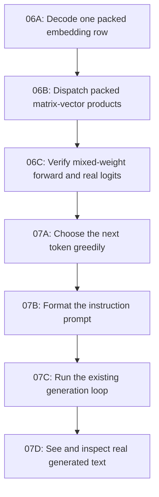

# Roadmap to Your First Generated Text

This is the complete generation path for the local
`models/qwen-2.5.gguf` (Qwen2.5-0.5B-Instruct). The goal is a short, readable
terminal response using your own forward pass. Keep the existing reference
implementations and full-prefix recomputation until this works.

All four algorithms are implemented. Their tests and contracts document
the path from packed model weights to greedy terminal generation.



The diagram shows implementation order. At runtime, prompt formatting comes
before tokenization and the forward pass.

| Step | Implementation | Checkpoint |
| --- | --- | --- |
| 06A | `qwen2_decode_quantized_embedding_row` in `src/qwen2_architecture.cpp` | `qwen2_embedding_reference_test` |
| 06B | Packed branch of `qwen2_weight_matvec` in the same file | `qwen2_matvec_reference_test` |
| 06C | Verify packed/F32 logits and cached/reference execution agree | `forward_quantized_reference_test`, `forward_reference_test` |
| 07A | `sampler_greedy_sample` in `src/sampler.cpp` | `sampler_greedy_test` |
| 07B | `qwen2_format_prompt` in `src/qwen2_architecture.cpp` | `prompt_format_reference_test` |
| 07C | Existing app loop with tested sequencing and cleanup | `app_generation_contract_test` passes with a scripted backend |
| 07D | Run the executable with the actual GGUF; inspect the response | Historical manual acceptance; outside the automated suite |

Start with [Milestone 06: quantized integration](milestone-06-quantized-forward.md).
Then follow [Milestone 07: first generated text](milestone-07-first-generated-text.md).
Those guides specify inputs, outputs, validation, tests, and completion criteria.

## Current test status

CTest contains 18 unit tests and four small integration tests. All use synthetic
fixtures or scripted backends; real-model acceptance checks and build targets
have been removed. `forward_reference_test` includes a three-token comparison
of cached and full-prefix execution using a four-dimensional model.

The older real-model results below are historical evidence from 2026-10-16.

```sh
./build.sh

# All automated checks, with no real-model loading.
ctest --test-dir build --output-on-failure

ctest --test-dir build -L '^unit$' --output-on-failure
ctest --test-dir build -L '^integration$' --output-on-failure

# Focused packed-forward and sampler/prompt regressions.
ctest --test-dir build -L milestone06-quantized --output-on-failure
ctest --test-dir build -L milestone07-exercises --output-on-failure
```

The app contract tests use synthetic token pieces to check sequencing and
errors. Forward integration tests use tiny in-memory models to check model math.

## Verified first output (2026-10-16)

```sh
./build/inference --model models/qwen-2.5.gguf \
  --prompt "Say hello." --max-tokens 1 --temperature 0 --top-p 1
```

The real model printed `Hello`, reported one generated token, and exited
successfully. The full CLI smoke check also printed
`The capital of France is Paris.` and passed. It took about 12 minutes for the
complete load/prefill/generation run on this machine. A missing model path and a maximum-length CLI prompt with an
excessive output request both failed cleanly. The separate real forward check
also passed its finite-logit, invalid-token, context, and cleanup checks.

Prefill can take minutes with full-prefix recomputation. The reported generation
elapsed time starts after prefill, so it does not measure that initial wait.

## Final acceptance

Run the automated suite. The CLI invocation is a separate, optional manual
exercise and may be slow:

```sh
cmake -S . -B build
cmake --build build --parallel
ctest --test-dir build --output-on-failure

./build/inference \
  --model models/qwen-2.5.gguf \
  --prompt "What is the capital of France?" \
  --max-tokens 16 --temperature 0 --top-p 1
```

When manually exercising the implementation, read the response:
it should be relevant, readable, and free of role markers. For this question,
it should identify Paris. Automated coverage of sequencing, EOS, limits, errors,
and cleanup uses the scripted app backend, without real model generation.

Repeat manually with `--max-tokens 1` to check the limit, a second short prompt
to check relevance, and an invalid model path to check a useful error. EOS
handling and partial-initialization cleanup already have deterministic tests.

There is no speed target. KV-cache reuse, batched prefill, SIMD, threading,
GPU work, stochastic temperature/top-p sampling, multi-turn chat, and replacing
the tokenizer adapter can follow after the first text milestone. First-text
commands explicitly use `--temperature 0`; the CLI default remains `0.8`
and its sampler path remains a clearly reported later feature.

For the next phase, review the [ranked optimization roadmap](optimization-roadmap.md).
